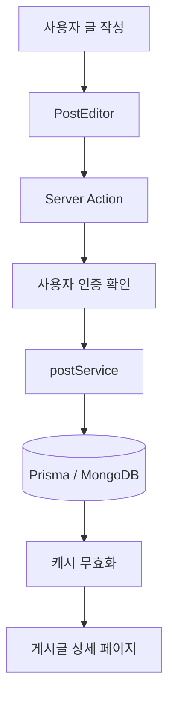

# 2026-11-05 TIL | Next.js 게시글 CRUD, Cache Components와 useOptimistic

## 1. 오늘 배운 내용

오늘은 Next.js에서 게시글을 작성하고 수정하거나, 댓글과 좋아요를 처리하는 기능을 살펴봤다.

이번 주 초에는 컴포넌트 설계와 회원가입, 로그인 인증을 주로 다뤘는데, 오늘은 그 기능들이 실제 게시글 서비스에서 어떻게 연결되는지 확인할 수 있었다.

특히 캐싱 부분이 기억에 남는다. 처음에는 캐시를 적용하면 데이터베이스 조회가 줄어든다는 정도로 이해했는데, 코드를 살펴보니 **캐시에 데이터를 저장하는 것과 캐시를 갱신하는 것은 별개의 작업**이었다.

`cacheTag`, `revalidateTag`, `updateTag`가 비슷한 역할을 하는 것처럼 보였지만, 실제로는 실행 시점과 다음 요청을 처리하는 방식에 차이가 있었다.

오늘 학습한 내용은 다음과 같다.

- Next.js 게시글 CRUD와 Prisma
- Server Action과 Service 계층 분리
- Cache Components와 `use cache`
- `cacheTag`, `cacheLife`, `revalidateTag`, `updateTag`
- 캐시 HIT와 MISS의 차이
- `useOptimistic`을 이용한 좋아요 처리
- `useFormStatus`와 폼 제출 상태
- Quill 에디터와 HTML 처리
- JWT 인증 및 Next.js Proxy
- `useActionState`와 회원가입
- Tailwind CSS와 Prettier

---

## 2. 이전 학습 복습

### 2.1 이번 주 학습 내용 연결하기

이번 주에 배운 내용을 날짜별로 다시 정리해 봤다.

| 날짜 | 학습 내용 | 오늘 내용과의 연결 |
|---|---|---|
| 11/02 | 컴포넌트 설계, FormData, REST API | 게시글 폼 데이터 전달 |
| 11/03 | 회원가입, Server Action, Prisma | 게시글 작성과 DB 작업 |
| 11/04 | NextAuth, OAuth, JWT | 게시글 작성자 인증 |
| 11/05 | CRUD, 캐싱, useOptimistic | 데이터 저장 및 화면 갱신 |

11월 2일과 3일에 살펴본 `FormData`는 게시글 작성에서도 사용된다.

```tsx
const body = String(formData.get("body") ?? "");
```

폼에서 전달된 `body` 값을 가져와 게시글 내용으로 사용하는 코드다.

11월 4일에 배운 JWT 인증도 오늘 다시 등장했다.

로그인할 때 발급된 토큰을 이용해 사용자를 확인하고, 글을 작성하거나 수정할 권한이 있는지 검증하는 데 활용된다.

이전에는 각각의 기능을 따로 공부했지만, 게시글 기능을 보면서 하나의 서비스 안에서 어떻게 연결되는지 조금 더 이해할 수 있었다.

---

## 3. 게시글 기능의 전체 구조

### 3.1 주요 파일

게시글 기능은 크게 UI, 서버 액션, 서비스, 캐시로 나뉜다.

```text
lgcns-fe-next/
├── app/
│   └── (post)/
│       ├── posts/
│       ├── postdetail/
│       └── (postsys)/
│           └── postwrite/
├── actions/
│   └── postActions.ts
├── component/
│   └── organisms/
│       ├── PostCard.tsx
│       ├── PostEditor.tsx
│       └── PostLiveRefresh.tsx
├── lib/
│   ├── postCache.ts
│   ├── currentUser.ts
│   └── accessJwt.ts
├── service/
│   └── postService.ts
└── proxy.ts
```

파일마다 맡은 역할은 다음과 같다.

| 파일 | 역할 |
|---|---|
| `PostCard.tsx` | 게시글, 좋아요, 댓글 표시 |
| `PostEditor.tsx` | 게시글 작성 및 수정 |
| `postActions.ts` | 서버 요청 처리 |
| `postService.ts` | 데이터 검증 및 Prisma 작업 |
| `postCache.ts` | 게시글 조회 결과 캐싱 |
| `currentUser.ts` | 현재 로그인 사용자 조회 |
| `accessJwt.ts` | JWT 생성 및 검증 |
| `proxy.ts` | 페이지 접근 전 인증 확인 |

### 3.2 게시글 작성 흐름



처음에는 Server Action에서 데이터베이스 작업까지 모두 처리해도 되지 않을까 생각했다.

그런데 파일을 나눠서 보면 각각의 역할이 더 명확했다.

Server Action은 사용자의 요청을 받고 인증 여부를 확인한다. Service는 실제 데이터 검증과 데이터베이스 작업을 처리한다.

이렇게 분리하면 화면이나 요청 방식이 바뀌더라도 Service 로직을 별도로 관리할 수 있다.

---

## 4. 코드 리뷰 ① 게시글 작성

### 4.1 createPost()

`actions/postActions.ts`의 게시글 작성 코드를 살펴봤다.

```tsx
export async function createPost(formData: FormData) {
  const user = await author("/postwrite");

  const result = await postService.createPost({
    authorId: user.id,
    authorName: user.name,
    body: String(formData.get("body") ?? ""),
  });

  if (!result.ok) return;

  updateTag("posts");

  redirect(`/postdetail/${result.id}`);
}
```

코드의 실행 순서는 다음과 같다.

1. `author()`로 로그인 사용자를 확인한다.
2. `FormData`에서 게시글 본문을 가져온다.
3. `postService.createPost()`를 호출한다.
4. 저장 결과를 확인한다.
5. 성공하면 `updateTag("posts")`를 실행한다.
6. 작성된 게시글의 상세 페이지로 이동한다.

### 4.2 작성자 정보는 어디에서 가져오는가?

```tsx
const user = await author("/postwrite");
```

작성자 ID를 사용자가 직접 입력해서 전달하는 것이 아니라 서버에서 현재 로그인한 사용자 정보를 확인한다.

만약 클라이언트에서 작성자 ID를 마음대로 전달할 수 있다면 다른 사용자의 이름으로 게시글을 작성할 가능성이 생긴다.

따라서 사용자 식별 정보는 서버에서 인증 결과를 바탕으로 확인하는 것이 중요하다.

### 4.3 저장 후 바로 이동하지 않는 이유

```tsx
if (!result.ok) return;

updateTag("posts");

redirect(`/postdetail/${result.id}`);
```

이 부분도 눈여겨봤다.

DB 저장에 성공했다고 바로 상세 페이지로 이동하면 기존에 캐싱된 게시글 목록이나 상세 데이터가 남아 있을 수 있다.

그래서 저장에 성공한 다음 캐시를 무효화하고 페이지를 이동한다.

여기서 `redirect()`는 단순히 다음 줄로 넘어가는 함수가 아니라 내부적으로 예외를 발생시켜 이동을 처리하므로, 실행 순서를 주의해야 한다.

---

## 5. Cache Components - use cache

### 5.1 캐시가 필요한 이유

게시글 목록은 여러 사용자가 반복해서 조회하는 데이터다.

모든 요청마다 DB를 조회하면 같은 데이터를 여러 번 가져오게 된다.

캐시는 한 번 조회한 결과를 저장해 두었다가 이후 요청에서 재사용하는 방식이다.

```text
캐시가 없는 경우

요청 A → DB 조회 → 응답
요청 B → DB 조회 → 응답
요청 C → DB 조회 → 응답

캐시가 있는 경우

요청 A → DB 조회 → 캐시 저장
요청 B → 캐시 반환
요청 C → 캐시 반환
```

다만 캐시에 저장한 데이터가 변경되면 언제 다시 조회해야 하는지도 결정해야 한다.

### 5.2 use cache

Next.js 16의 Cache Components에서는 `"use cache"`를 사용해 함수의 결과를 캐싱할 수 있다.

게시글 목록 조회 코드는 다음과 같다.

```tsx
import { cacheLife, cacheTag } from "next/cache";

export async function getCachedPosts(
  pageNumber: number,
  sortOrder: "ASC" | "DESC",
): Promise<PostListResponseType> {
  "use cache";

  cacheTag("posts");
  cacheLife("max");

  return postService.listPosts(pageNumber, sortOrder);
}
```

각 코드의 역할은 다음과 같다.

| 코드 | 역할 |
|---|---|
| `"use cache"` | 함수의 결과를 캐싱 |
| `cacheTag("posts")` | 캐시 항목에 태그 지정 |
| `cacheLife("max")` | 캐시 수명 정책 설정 |
| `postService.listPosts()` | 실제 데이터베이스 조회 |

`pageNumber`와 `sortOrder` 같은 입력값도 캐시 항목을 구분하는 기준에 포함된다.

예를 들어 최신순 1페이지와 오래된순 2페이지는 서로 다른 조회 결과이므로 다른 캐시 항목으로 관리할 수 있다.

---

## 6. cacheTag는 언제 실행될까?

### 6.1 cacheTag의 역할

오늘 캐시를 공부하면서 가장 먼저 구분해야 했던 부분이다.

```tsx
cacheTag("posts");
```

처음에는 이름에 Tag가 붙어 있어서 캐시를 갱신하거나 다시 조회하게 만드는 함수라고 생각하기 쉬웠다.

하지만 `cacheTag()`의 역할은 **캐시 항목에 이름표를 붙이는 것**이다.

캐시를 갱신하거나 만료시키는 함수는 아니다.

### 6.2 캐시 HIT와 MISS

캐시가 있는지 여부에 따라 함수의 실행 과정이 달라진다.

| 상황 | 함수 본문 | DB 조회 | cacheTag 실행 |
|---|---|---|---|
| 최초 캐시 MISS | 실행 | 실행 | 실행 |
| 유효한 캐시 HIT | 실행 안 함 | 실행 안 함 | 실행 안 함 |
| 캐시 만료 후 재계산 | 다시 실행 | 다시 실행 | 다시 실행 |

여기서 중요한 부분은 캐시 HIT다.

`getCachedPosts()`를 호출하더라도 이미 유효한 캐시가 있다면 함수 본문을 다시 실행하지 않는다.

따라서 함수 내부의 `cacheTag()`나 `postService.listPosts()`도 실행되지 않는다.

실제로 캐시가 존재하는 경우에는 기존에 저장된 결과를 반환한다.

### 6.3 캐시 생성 시점

캐시가 처음 생성되는 시점이 반드시 첫 번째 사용자 요청인 것은 아니다.

정적으로 사전 렌더링할 수 있는 콘텐츠라면 `next build` 과정에서 캐시가 생성될 수도 있다.

반대로 요청 시점의 데이터가 필요한 경우에는 실제 요청이 들어왔을 때 캐시를 생성하게 된다.

### 6.4 캐시 키와 태그의 차이

이 부분도 따로 정리해 두려고 한다.

- 캐시 키: 서로 다른 결과를 구분하는 기준
- 캐시 태그: 관련된 캐시 항목들을 묶어서 관리하는 이름

예를 들어 다음 두 함수 호출은 서로 다른 데이터를 반환할 수 있다.

```tsx
getCachedPosts(1, "DESC");
getCachedPosts(2, "ASC");
```

두 요청은 서로 다른 캐시 항목이지만, 둘 다 `"posts"` 태그를 사용할 수 있다.

따라서 `updateTag("posts")`를 호출하면 해당 태그를 공유하는 캐시 항목들이 함께 만료된다.

**정리하면 `cacheTag()`는 캐시를 갱신하는 함수가 아니라, 나중에 캐시를 무효화할 수 있도록 그룹을 지정하는 함수다.**

---

## 7. cacheLife와 캐시 수명

### 7.1 cacheLife()

캐시가 얼마나 오래 재사용될지 설정할 때 `cacheLife()`를 사용한다.

현재 게시글 조회에서는 다음과 같이 설정되어 있다.

```tsx
cacheLife("max");
```

`max`는 장기간 캐싱할 콘텐츠에 사용하는 프리셋이다.

설정값은 다음과 같다.

| 설정 | max 프리셋 |
|---|---|
| `stale` | 5분 |
| `revalidate` | 30일 |
| `expire` | 1년 |

각 값은 서로 다른 역할을 한다.

- `stale`: 클라이언트 라우터가 데이터를 신선한 상태로 취급하는 시간
- `revalidate`: 서버에서 캐시를 재검증하는 기준 시간
- `expire`: 기존 캐시를 더 이상 그대로 사용할 수 없는 만료 기준

`stale`은 단순히 DB 데이터가 5분 후 삭제된다는 뜻이 아니다.

### 7.2 max를 설정하면 계속 DB를 조회하는가?

처음에는 `revalidate`가 30일이라고 하면 서버가 30일마다 자동으로 DB를 조회하는 것인지 헷갈릴 수 있다.

하지만 요청이 없는 동안 계속 DB를 조회하는 방식은 아니다.

캐시가 재검증 조건에 해당하더라도 실제 재검증은 이후 요청이 들어왔을 때 시작된다.

또한 `updateTag()`처럼 별도의 무효화가 발생하면 설정된 수명보다 먼저 캐시가 만료될 수 있다.

즉, `cacheLife("max")`가 설정되어 있어도 실제 데이터 변경을 반영할 수 있다.

---

## 8. revalidateTag와 updateTag의 차이

### 8.1 두 함수가 필요한 이유

게시글을 새로 작성하면 데이터베이스의 내용은 변경된다.

하지만 캐시에는 이전 게시글 목록이 남아 있을 수 있다.

이때 캐시를 어떤 방식으로 갱신할지 결정해야 한다.

Next.js에서는 `revalidateTag()`와 `updateTag()`를 사용할 수 있다.

### 8.2 revalidateTag()

```tsx
revalidateTag("posts", "max");
```

이 방식은 기존 캐시를 stale 상태로 표시한다.

다음 요청이 들어오면 기존 캐시를 먼저 제공할 수 있고, 백그라운드에서 새로운 데이터를 조회해 갱신한다.

이를 SWR(Stale-While-Revalidate) 방식이라고 한다.

일반적인 게시판이나 블로그처럼 잠깐 이전 목록이 표시되어도 괜찮은 경우에 적합하다.

### 8.3 updateTag()

```tsx
updateTag("posts");
```

`updateTag()`는 해당 태그의 캐시를 즉시 만료시킨다.

이후 새로운 데이터가 필요하면 최신 결과를 생성할 때까지 기다리게 된다.

게시글을 작성한 사용자가 목록으로 이동했을 때 방금 작성한 글이 반드시 보여야 하는 경우에 사용할 수 있다.

이러한 특성을 Read-Your-Own-Writes라고 한다.

`updateTag()`는 Server Action에서 사용하는 함수라는 점도 기억해야 한다.

### 8.4 차이 비교

| 구분 | revalidateTag | updateTag |
|---|---|---|
| 주요 목적 | 기존 캐시를 사용하면서 갱신 | 캐시 즉시 만료 |
| 다음 요청 | 기존 데이터 우선 반환 가능 | 새로운 데이터 생성까지 대기 |
| 갱신 방식 | Stale-While-Revalidate | Read-Your-Own-Writes |
| 적합한 경우 | 일반 게시판·블로그 | 작성 직후 최신 데이터 확인 |
| 실행 위치 | Server Action, Route Handler | Server Action |

`revalidateTag("posts", "max")`와 `updateTag("posts")`는 둘 다 데이터 변경 시 사용할 수 있지만, 사용자에게 언제 최신 데이터를 보여줘야 하는지에 따라 선택해야 한다.

### 8.5 또 다른 revalidateTag 방식

```tsx
revalidateTag("posts", { expire: 0 });
```

이 방식은 캐시를 즉시 만료시키는 재검증 방법이다.

Route Handler에서 즉시 캐시를 만료시켜야 할 때 고려할 수 있다.

다만 이 옵션은 Next.js 버전에 따라 지원 여부와 타입 정의를 확인할 필요가 있다.

이번 캐시 비교는 Next.js 16.4.5 기준의 내용도 포함하고 있으며, 프로젝트에서는 Next.js 16.4.3을 사용하고 있기 때문이다.

---

## 9. 게시글 등록 상황으로 비교하기

### 9.1 상황 설정

사용자 A가 새로운 게시글을 작성했다고 가정해 보자.

다른 사용자 B는 기존 게시글 목록을 보고 있다.

### 9.2 revalidateTag를 사용하는 경우

```text
A가 게시글 작성
       │
       ▼
DB 저장 완료
       │
       ▼
revalidateTag("posts", "max")
       │
       ▼
기존 캐시 stale 처리
       │
       ▼
B가 게시글 목록 요청
       │
       ▼
기존 목록을 먼저 받을 수 있음
       │
       ▼
백그라운드 재검증
       │
       ▼
이후 요청에서 최신 목록 반환
```

이 방식은 응답 속도와 데이터 최신성 사이에서 균형을 맞추는 방법이다.

### 9.3 updateTag를 사용하는 경우

```text
A가 게시글 작성
       │
       ▼
DB 저장 완료
       │
       ▼
updateTag("posts")
       │
       ▼
기존 캐시 즉시 만료
       │
       ▼
새로운 게시글 목록 조회
       │
       ▼
최신 결과 반환
```

게시글을 작성한 직후 최신 목록을 확인해야 한다면 이 방식이 더 적합하다.

### 9.4 코드 비교

**방법 A - SWR 방식**

```tsx
"use server";

import { revalidateTag } from "next/cache";

export async function createPostExample(data: PostInput) {
  await db.post.create({ data });
  revalidateTag("posts", "max");
}
```

**방법 B - 즉시 반영 방식**

```tsx
"use server";

import { updateTag } from "next/cache";

export async function createPostExample(data: PostInput) {
  await db.post.create({ data });
  updateTag("posts");
}
```

위 코드는 두 가지 무효화 전략을 비교하기 위해 단순화한 예시다.

현재 게시글 작성 코드에서는 `updateTag("posts")`를 사용한다.

같은 태그에 대해 두 무효화 방식을 동시에 호출하기보다, 원하는 최신성 수준에 맞춰 하나를 선택하는 것이 좋다.

### 9.5 어떤 방식을 선택할까?

게시글을 읽는 대부분의 사용자에게 몇 초 정도 이전 목록을 보여줘도 괜찮다면 SWR 방식이 적합할 수 있다.

반대로 글을 작성한 사용자가 곧바로 자신의 글을 확인해야 한다면 즉시 만료가 유리하다.

결국 캐싱은 단순히 성능을 높이는 문제가 아니라, **서비스에서 어느 정도의 데이터 지연을 허용할지 결정하는 문제**이기도 했다.

---

## 10. 캐시 설계에서 추가로 생각해 볼 점

### 10.1 태그를 너무 넓게 사용하면?

현재 게시글 목록과 상세 데이터는 `"posts"` 태그를 공유한다.

따라서 특정 게시글에 좋아요 하나가 추가되어도 게시글 목록과 다른 게시글의 캐시까지 만료될 수 있다.

게시글별로 태그를 세분화하면 일부 변경사항에 대해서는 더 좁은 범위의 캐시만 만료하도록 설계할 수 있다.

예를 들면 다음과 같다.

```tsx
cacheTag("posts");
cacheTag(`post-${postId}`);
```

다만 두 태그를 함께 지정한 상태에서 `updateTag("posts")`를 호출하면 여전히 전체 캐시가 만료된다.

따라서 태그 이름을 추가하는 것만으로 최적화가 끝나는 것은 아니고, 실제 무효화 코드를 함께 변경해야 한다.

### 10.2 사용자별 데이터는 어떻게 처리할까?

공통 게시글 목록과 로그인 사용자의 좋아요 여부는 성격이 다르다.

게시글 내용은 여러 사용자가 공유할 수 있지만, 내가 좋아요를 눌렀는지는 사용자마다 달라진다.

그래서 공통 게시글 데이터와 사용자별 상태를 구분하여 처리해야 한다.

또한 일반적인 `"use cache"` 함수 안에서는 `cookies()`나 `headers()` 같은 요청 시점 API를 직접 읽지 않아야 한다.

사용자 정보는 캐시 밖에서 확인하고, 필요한 값만 별도로 처리하는 구조가 중요하다.

### 10.3 서버가 여러 대라면?

기본 인메모리 캐시는 서버 프로세스별로 관리된다.

서버 인스턴스가 여러 대라면 한 서버에서 캐시를 만료시켰다고 다른 서버의 캐시까지 자동으로 동일하게 처리된다고 가정할 수 없다.

서비스 규모가 커지면 공유 캐시나 캐시 무효화 동기화도 고려해야 한다.

이 부분은 아직 실제 운영 환경에서 확인한 내용은 아니지만, 캐시를 설계할 때 알아둘 필요가 있는 개념이라고 생각한다.

---

## 11. 코드 리뷰 ③ useOptimistic과 좋아요

### 11.1 useOptimistic이란?

좋아요 버튼을 누른 뒤 서버 응답이 올 때까지 기다리면 화면 반응이 늦어질 수 있다.

`useOptimistic`은 서버 요청이 진행되는 동안 화면의 상태를 먼저 변경하는 Hook이다.

이를 낙관적 업데이트(Optimistic Update)라고 한다.

```text
일반적인 처리

클릭 → 서버 요청 → DB 변경 → 응답 → 화면 갱신

낙관적 업데이트

클릭 → 화면 먼저 갱신
            │
            ▼
          서버 요청
            │
            ▼
        실제 결과 반영
```

### 11.2 좋아요 상태 계산

`PostCard.tsx`의 좋아요 상태 계산 코드를 살펴봤다.

```tsx
function applyLike(
  current: { count: number; liked: boolean },
  nextLiked: boolean,
) {
  if (nextLiked === current.liked) return current;

  return {
    liked: nextLiked,
    count: Math.max(
      0,
      current.count + (nextLiked ? 1 : -1),
    ),
  };
}
```

좋아요를 누르면 수를 1 증가시키고, 취소하면 1 감소시킨다.

또한 `Math.max(0, ...)`을 이용해 좋아요 수가 음수가 되지 않도록 처리한다.

### 11.3 useOptimistic 적용

```tsx
const [like, setLike] = useOptimistic(
  { count, liked },
  applyLike
);
```

실제 폼 액션에서는 다음과 같이 사용한다.

```tsx
<form
  action={async (formData) => {
    setLike(!like.liked);
    await toggleLike(formData);
  }}
>
  <input
    type="hidden"
    name="postId"
    value={postId}
  />

  <LikeSubmit
    count={like.count}
    liked={like.liked}
  />
</form>
```

실행 순서는 다음과 같다.

1. 사용자가 좋아요 버튼을 클릭한다.
2. `setLike()`를 이용해 화면을 먼저 변경한다.
3. `toggleLike()` Server Action이 실행된다.
4. 서버에서 기존 좋아요를 확인한다.
5. 좋아요가 있으면 삭제하고 없으면 생성한다.
6. 성공하면 `updateTag("posts")`를 호출한다.
7. 서버에서 갱신된 데이터가 화면에 반영된다.

### 11.4 useFormStatus

서버 작업 중 좋아요 버튼이 중복으로 눌리는 상황을 줄이기 위해 `useFormStatus()`를 사용한다.

```tsx
function LikeSubmit({
  count,
  liked,
}: {
  count: number;
  liked: boolean;
}) {
  const { pending } = useFormStatus();

  return (
    <button
      type="submit"
      disabled={pending}
      aria-pressed={liked}
    >
      좋아요 {count}
    </button>
  );
}
```

`pending`이 `true`이면 버튼을 비활성화한다.

### 11.5 헷갈렸던 부분

`useOptimistic`과 `useState` 모두 화면의 상태를 변경하기 때문에 처음에는 비슷하게 느껴졌다.

하지만 목적이 다르다.

- `useState`: 일반적인 컴포넌트 상태를 관리
- `useOptimistic`: 서버 요청 중 임시로 변경된 상태를 표시

또한 `useOptimistic`은 데이터베이스를 직접 변경하지 않는다.

실제 저장은 Server Action과 Service가 담당하고, `useOptimistic`은 사용자가 서버 응답을 기다리는 동안 화면에 보여줄 값을 처리한다.

---

## 12. Quill 에디터와 HTML 데이터 처리

### 12.1 Quill

게시글 작성에는 Quill 리치 텍스트 에디터를 사용한다.

일반적인 `<textarea>`와 달리 제목, 굵게, 기울임, 목록, 링크 등의 서식을 적용할 수 있다.

### 12.2 동적 import

`PostEditor.tsx`에서는 Quill을 다음과 같이 불러온다.

```tsx
const { default: QuillEditor } =
  await import("quill");

editor = new QuillEditor(host, {
  theme: "snow",
  modules: { toolbar },
});
```

이 코드는 `useEffect` 안에서 실행된다.

Quill은 브라우저 DOM을 이용하므로 서버에서 바로 에디터를 생성하지 않고 브라우저에서 필요한 시점에 초기화한다.

### 12.3 작성한 내용 가져오기

에디터의 본문은 다음 메서드로 가져온다.

```tsx
editor.getSemanticHTML();
```

반환된 HTML을 hidden input에 저장하고 Server Action으로 전달한다.

```tsx
<input
  type="hidden"
  name="body"
  value={html}
/>
```

### 12.4 HTML 저장 시 주의점

사용자가 입력한 HTML을 그대로 렌더링하면 XSS 문제가 발생할 수 있다.

이를 방지하기 위해 `sanitize-html`을 사용하여 허용된 태그와 속성만 남기는 처리가 필요하다.

게시글 본문은 실제 텍스트가 1자 이상 5,000자 이하인지 검증한다.

댓글은 일반 텍스트로 처리하고 최대 300자로 제한한다.

React에서 HTML을 직접 출력할 때는 다음 속성을 사용한다.

```tsx
<div
  dangerouslySetInnerHTML={{
    __html: post.body,
  }}
/>
```

이 방식은 HTML 문자열을 실제 HTML로 처리하므로 반드시 안전하게 정제된 데이터에 적용해야 한다.

---

## 13. JWT 인증과 Proxy 복습

### 13.1 JWT 인증

이전에 배웠던 NextAuth와 JWT가 게시글 기능에서도 사용된다.

현재 코드에서는 `jose` 라이브러리로 JWT를 생성하고 검증한다.

```tsx
import { SignJWT, jwtVerify } from "jose";
```

JWT에는 사용자 식별 정보 등이 포함되며, 서버에서 서명과 유효 기간을 검증한다.

토큰의 유효 기간은 2시간이다.

### 13.2 Proxy

Next.js의 `proxy.ts`는 페이지 렌더링 전에 인증 여부를 확인한다.

예를 들어 로그인하지 않은 사용자가 글쓰기 페이지에 접근하면 로그인 페이지로 이동시킨다.

```text
/postwrite
    │
    ▼
/login?callbackUrl=/postwrite
```

`callbackUrl`은 로그인 이후 원래 접근하려던 페이지로 돌아가기 위해 사용한다.

### 13.3 Proxy와 권한 검증의 차이

Proxy가 인증을 확인했다고 해서 모든 작업을 허용해서는 안 된다.

게시글을 수정하거나 삭제할 때는 실제 작성자도 확인해야 한다.

따라서 Proxy는 페이지 접근을 제어하고, Server Action과 Service에서는 데이터 변경 권한을 다시 검증하는 역할을 맡는다.

### 13.4 OAuth와의 연결

어제 살펴본 Google·Kakao OAuth 로그인은 외부 서비스에서 사용자를 인증하는 과정이었다.

오늘 구조에서는 소셜 계정을 내부 사용자 정보와 연결하고, 애플리케이션에서 사용할 JWT를 별도로 발급한다.

이렇게 하면 외부 서비스별 Access Token 형식에 의존하지 않고 내부 사용자 인증과 권한 처리를 공통된 방식으로 관리할 수 있다.

---

## 14. 회원가입과 UI 관련 추가 학습

### 14.1 useActionState

회원가입에서는 `useActionState()`로 서버 액션의 처리 결과와 입력 상태를 관리한다.

```tsx
const [state, formAction, actionPending] =
  useActionState(
    action,
    initialSignupState
  );
```

회원가입은 다음 네 단계로 구성된다.

```text
아이디
  ↓
비밀번호
  ↓
이메일
  ↓
프로필 이미지
```

상태 관리에는 `useActionState`를 사용하고, 다음 단계 화면을 먼저 표시하는 데 `useOptimistic`도 사용한다.

### 14.2 Tailwind CSS

로그인과 회원가입 화면은 Tailwind CSS 유틸리티 클래스를 이용한다.

```tsx
className="
  w-full
  max-w-[484px]
  rounded-[24px]
  bg-white
  px-8
"
```

React와 Vite 기반 프로젝트에서는 `@tailwindcss/vite` 플러그인을 사용한다.

```tsx
export default defineConfig({
  plugins: [react(), tailwindcss()],
});
```

CSS에서는 다음 구문을 사용한다.

```css
@import "tailwindcss";
```

### 14.3 Prettier

Prettier는 코드 스타일을 일정하게 정리하는 도구다.

```json
{
  "semi": true,
  "singleQuote": false,
  "trailingComma": "all"
}
```

프로젝트에 설정된 명령어는 다음과 같다.

```bash
npm run format
```

포맷팅 결과가 파일에 직접 반영되므로 Git에 커밋하기 전 변경 내용을 확인하는 것이 좋다.

---

## 15. 헷갈렸던 내용 정리

오늘은 비슷해 보이지만 실제 역할이 다른 기능들이 많았다.

| 개념 | 다시 정리한 내용 |
|---|---|
| Server Action | 서버 요청을 처리하는 함수 |
| Service | 비즈니스 로직과 데이터베이스 작업 |
| `use cache` | 함수 결과 캐싱 |
| `cacheTag` | 캐시 항목에 태그 지정 |
| `cacheLife` | 캐시 수명 정책 설정 |
| `revalidateTag` | stale 처리 및 재검증 또는 지정한 만료 방식 수행 |
| `updateTag` | 캐시 즉시 만료 |
| `useState` | 일반적인 컴포넌트 상태 관리 |
| `useOptimistic` | 서버 응답 전에 임시 화면 상태 표시 |
| `useFormStatus` | 폼 제출 진행 상태 확인 |
| Proxy | 페이지 접근 전 인증 확인 |
| JWT 검증 | 토큰의 서명과 유효성 확인 |

그중 가장 헷갈리기 쉬웠던 부분은 `cacheTag()`와 `revalidateTag()`였다.

이름만 보면 둘 다 캐시를 갱신하는 함수처럼 느껴지지만, `cacheTag()`는 캐시에 이름표를 붙이는 함수이고 `revalidateTag()`는 해당 태그의 캐시를 재검증하도록 처리하는 함수다.

`updateTag()`는 즉시 만료시키기 때문에 새 데이터를 바로 확인해야 하는 상황에 더 적합하다.

또한 `cacheLife("max")`를 설정했다고 해서 서버가 계속 DB를 조회하는 것이 아니라는 점도 새롭게 정리할 수 있었다.

---

## 16. 다음에 직접 해볼 작업

다음에는 게시글 기능을 직접 실행하면서 오늘 살펴본 코드의 동작을 확인해 보려고 한다.

우선 게시글을 작성한 뒤 `postActions.ts`에서 어떤 순서로 함수가 실행되는지 확인하고 싶다. 특히 글이 정상적으로 저장된 경우에만 `updateTag("posts")`가 호출되는지 살펴볼 생각이다.

캐싱 부분은 같은 게시글 목록을 여러 번 조회하면서 실제 DB 조회 로그가 어떻게 달라지는지 확인해 보고 싶다. 캐시 HIT일 때 함수 본문이 다시 실행되지 않는지, 캐시를 무효화한 이후에는 어떤 변화가 발생하는지 비교하면 이해하는 데 도움이 될 것 같다.

또한 `revalidateTag("posts", "max")`와 `updateTag("posts")`의 차이도 간단한 예제로 확인해 보고 싶다. 특히 게시글을 작성한 직후 목록으로 이동했을 때 데이터가 언제 갱신되는지 비교해 보면 좋을 것 같다.

좋아요 기능에서는 `useOptimistic`으로 화면이 먼저 변경되는 과정과 서버 응답 이후 실제 값이 반영되는 과정을 확인할 예정이다.

마지막으로 Quill 에디터에서 작성한 HTML이 서버로 전달되고 정제된 후 데이터베이스에 저장되는 과정도 살펴보고 싶다.

---

## 17. 오늘의 회고

오늘은 게시글 CRUD를 중심으로 지금까지 배운 내용을 연결해서 정리할 수 있었다.

처음에는 Next.js의 Server Component, Client Component, Server Action을 구분하는 것도 쉽지 않았는데, 회원가입과 로그인, 게시글 기능을 계속 살펴보니 각 기능이 어떤 역할을 맡는지 조금씩 이해되고 있다.

특히 캐싱 부분이 기억에 남는다.

캐시를 적용하면 무조건 성능이 좋아진다고 생각하기 쉬운데, 실제로는 캐시를 언제 생성하고 언제 무효화하는지가 중요했다.

오늘 `cacheTag`, `revalidateTag`, `updateTag`를 비교하면서 같은 게시글 기능이라도 데이터의 최신성이 얼마나 중요한지에 따라 다른 방식을 선택할 수 있다는 점을 알게 됐다.

`cacheTag()`가 데이터를 갱신하는 함수가 아니라 단순히 태그를 붙이는 역할이라는 점도 확실히 구분할 수 있었다.

좋아요 기능에서 사용한 `useOptimistic`도 흥미로웠다. 서버의 실제 처리 결과가 나오기 전에 화면을 변경하는 방식이어서, 사용자 경험을 고려한 기능이라는 점이 인상적이었다.

또한 어제 배운 JWT 인증이 오늘 게시글 작성자의 권한을 확인하는 데 사용되면서, 인증이 단순히 로그인 화면을 만드는 것으로 끝나지 않는다는 점을 다시 느꼈다.

아직 모든 코드를 혼자 작성하기는 어렵지만, 코드를 읽으면서 **사용자 요청 → 서버 처리 → DB 저장 → 캐시 갱신 → 화면 반영**으로 이어지는 흐름을 이해하는 것이 우선이라고 생각한다.

다음에는 캐시 관련 함수를 직접 실행하고 비교해 보면서 개념으로 이해한 내용을 실제 동작과 연결해 보고 싶다.

**오늘의 한 줄 정리**

Next.js 게시글 CRUD를 통해 서버와 클라이언트의 데이터 처리 흐름을 복습했고, `cacheTag`, `revalidateTag`, `updateTag`의 차이와 `useOptimistic`을 이용한 화면 갱신 방식을 학습했다.

---

## 18. 참고 자료

- [Next.js 공식 문서](https://nextjs.org/docs)
- [Next.js Cache Components](https://nextjs.org/docs/app/getting-started/cache-components)
- [Next.js use cache](https://nextjs.org/docs/app/api-reference/directives/use-cache)
- [Next.js cacheTag](https://nextjs.org/docs/app/api-reference/functions/cacheTag)
- [Next.js cacheLife](https://nextjs.org/docs/app/api-reference/functions/cacheLife)
- [Next.js revalidateTag](https://nextjs.org/docs/app/api-reference/functions/revalidateTag)
- [Next.js updateTag](https://nextjs.org/docs/app/api-reference/functions/updateTag)
- [Next.js Server Actions](https://nextjs.org/docs/app/getting-started/mutating-data)
- [React useOptimistic](https://react.dev/reference/react/useOptimistic)
- [React useActionState](https://react.dev/reference/react/useActionState)
- [React useFormStatus](https://react.dev/reference/react-dom/hooks/useFormStatus)
- [Prisma](https://www.prisma.io/docs/)
- [Quill](https://quilljs.com/docs/quickstart)
- [Tailwind CSS](https://tailwindcss.com/docs)
- [Prettier](https://prettier.io/docs/)
