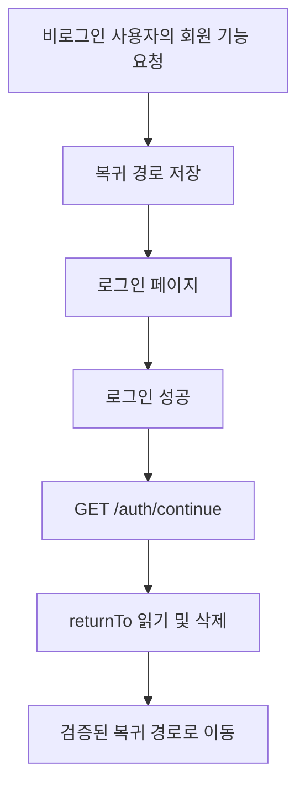
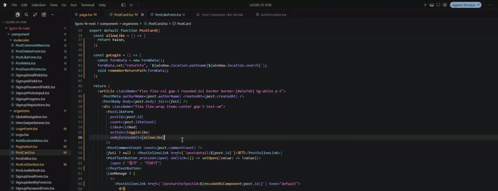
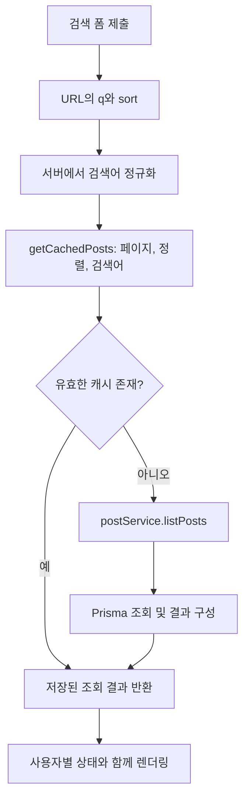
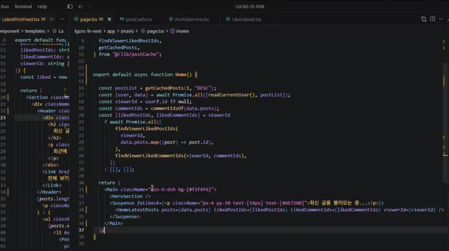
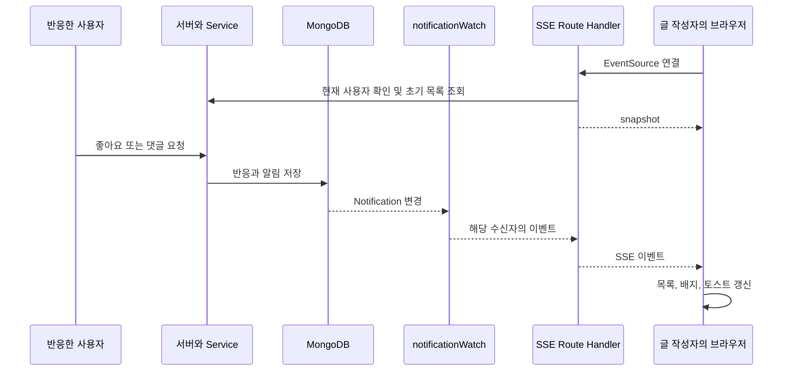

# 2026-11-06 TIL | Next.js 로그인 복귀, 검색과 캐시, SSE 알림 흐름


## 1. 오늘 정리한 내용

11월 5일에는 게시글을 저장하고 캐시를 갱신하는 흐름을 정리했다. 이번에는 그 게시글 기능에서 로그인하지 않은 사용자를 어떻게 안내하는지, 검색 조건을 어떻게 전달하는지, 다른 사람의 활동을 어떻게 알림으로 보여 주는지 연결해서 살펴봤다.

게시글 하나에 좋아요를 누르는 동작에도 여러 처리가 들어간다. 로그인 여부를 확인하고, 필요하면 로그인 화면으로 이동했다가 돌아와야 한다. 로그인한 상태라면 화면을 먼저 바꾸고 서버에서 실제 데이터를 저장한다. 다른 사람이 내 글에 반응했을 때는 알림 데이터를 만들고, 글 작성자의 브라우저까지 전달한다.

이번 정리에서는 **인증 확인, 화면의 임시 상태, DB 저장, 캐시 무효화, 실시간 알림을 각각 나눠서 읽는 것**에 초점을 맞췄다.

- 로그인 후 원래 페이지로 돌아오는 `returnTo` 쿠키
- HTML GET 폼을 이용한 게시글 검색
- 검색어가 추가된 `use cache`의 캐시 구분
- 댓글 목록을 펼치는 체크박스와 Tailwind CSS
- 서버에서 공통 게시글 데이터와 사용자별 상태를 합치는 과정
- 알림 저장과 MongoDB change stream, SSE의 연결
- `useEffect`에서 연결을 열고 정리하는 과정

---

## 2. 이전 학습 복습

### 2.1 게시글 CRUD에서 이어지는 부분

어제 정리한 기본 흐름은 다음과 같다.

```text
사용자 입력 → Server Action → 인증 확인 → Service → DB 변경
                                                    ↓
                                               캐시 무효화
                                                    ↓
                                                 화면 반영
```

오늘 확인한 코드도 이 구조를 유지한다. 달라진 점은 사용자가 로그인하지 않았을 때 이동할 경로를 보관하고, 좋아요나 댓글 저장이 다른 사용자에게 전달할 알림으로도 이어진다는 것이다.

| 이전 내용 | 이번 코드에서 연결되는 부분 |
|---|---|
| 게시글 CRUD | 좋아요·댓글 저장 후 알림 데이터 생성 |
| `cacheTag`, `updateTag` | 검색 조건별 게시글 캐시도 `posts` 태그로 관리 |
| `useOptimistic` | 요청 중 임시 화면 상태와 서버 저장 결과 구분 |
| JWT와 사용자 인증 | 서버에서 현재 사용자를 확인하고 본인 알림만 조회 |
| Server / Client Component | 서버의 초기 조회와 브라우저의 이벤트 연결 분리 |

### 2.2 로그인 복귀 쿠키는 인증 토큰과 다르다

JWT는 사용자를 인증하는 데 사용한다. 반면 `returnTo` 쿠키는 로그인 후 어디로 이동할지 기억한다.

따라서 `returnTo`가 있다고 로그인된 것은 아니다. 서버는 별도로 현재 사용자를 확인한다. 좋아요 버튼의 로그인 안내도 사용자 경험을 위한 처리이고, 실제 데이터 변경의 인증 확인은 서버에 남아 있어야 한다.

---

## 3. 주요 파일과 역할

아래 경로는 모두 `lgcns-fe-next/` 기준이다. 본문의 코드는 조회 시점 GitHub 커밋 `b10c94db42cb9c58d509f06797066b099535a223`을 기준으로 읽었다. 영상 속 작업 중간 코드와 동일한 시점이라고 가정하지 않았다.

| 파일 | 역할 |
|---|---|
| `actions/postActions.ts` | 로그인 확인, 게시글 관련 요청, 캐시 무효화 |
| `actions/returnToActions.ts` | 복귀 경로 저장 후 로그인 페이지 이동 |
| `lib/returnTo.ts` | 복귀 쿠키 옵션과 경로 인코딩·디코딩 |
| `app/auth/continue/route.ts` | 복귀 쿠키를 읽고 삭제한 뒤 원래 경로로 이동 |
| `component/molecules/PostSearchForm.tsx` | 검색어와 정렬 조건을 GET 폼으로 전달 |
| `lib/postCache.ts` | 페이지·정렬·검색어별 게시글 조회 캐싱 |
| `service/postService.ts` | 검색, 댓글 묶음 구성, 좋아요·댓글 및 알림 저장 |
| `component/organisms/PostCard.tsx` | 게시글 표시와 로그인 안내, 댓글 영역 구성 |
| `service/notificationService.ts` | 사용자별 알림 조회와 읽음 처리 |
| `service/notificationWatch.ts` | MongoDB 변경을 구독하고 수신자별로 전달 |
| `app/api/notifications/stream/route.ts` | 인증된 사용자에게 SSE 응답 제공 |
| `component/molecules/NotificationStream.tsx` | 브라우저의 EventSource 연결 관리 |
| `component/organisms/NotificationMenu.tsx` | 알림 목록, 읽지 않은 개수, 토스트 표시 |

---

## 4. 코드 리뷰 ① 로그인 후 원래 페이지로 돌아오기

### 4.1 서버에서도 사용자를 확인한다

`actions/postActions.ts`의 실제 코드다.

```ts
function requestedPath(formData: FormData, fallback: string) {
  const value = formData.get("returnTo");
  return typeof value === "string" && value.trim() ? value : fallback;
}

async function author(formData: FormData, fallback: string) {
  const user = await readCurrentUser();
  if (!user) {
    await saveReturnTo(requestedPath(formData, fallback));
    redirect("/login");
  }
  return user;
}
```

먼저 `readCurrentUser()`로 현재 사용자를 확인한다. 로그인하지 않았다면 폼에 담긴 `returnTo` 또는 대체 경로를 저장하고 `/login`으로 이동한다.

여기서 폼의 `returnTo`는 작성자 ID가 아니라 복귀할 주소다. 데이터 변경에 사용하는 사용자 ID는 서버의 인증 결과에서 가져온다.

11월 5일 TIL의 `author("/postwrite")`와 비교하면, 현재 코드는 `author(formData, fallback)` 형태다. 폼에서 전달한 현재 위치를 읽을 수 있도록 인자가 달라졌다.

### 4.2 경로를 잠시 기억하는 쿠키

`lib/returnTo.ts`의 옵션 함수다.

```ts
function returnToCookieOptions() {
  return {
    httpOnly: true,
    sameSite: "lax" as const,
    path: "/",
    maxAge: RETURN_TO_MAX_AGE,
    secure: process.env.NODE_ENV === "production",
  };
}
```

`RETURN_TO_MAX_AGE`는 `60 * 30`이다. 복귀 주소를 30분 동안 보관하도록 설정한다. `httpOnly`이므로 브라우저의 `document.cookie`로 읽는 용도가 아니다.

저장·복원 시에는 `safeCallbackPath`를 통과시키고 인코딩·디코딩한다. 사용자가 넘긴 주소를 무조건 이동 대상으로 사용하는 구조가 아니라는 점을 함께 봐야 한다.

### 4.3 로그인 후 쿠키를 읽고 지운다

`app/auth/continue/route.ts`의 실제 함수다.

```ts
export async function GET(request: Request) {
  const jar = await cookies();
  const path = decodeReturnTo(jar.get(RETURN_TO_COOKIE)?.value);
  jar.delete(RETURN_TO_COOKIE);
  return NextResponse.redirect(new URL(path, request.url));
}
```

실행 순서는 쿠키 읽기, 경로 복원, 쿠키 삭제, 리다이렉트다. 사용한 복귀 정보를 지워 다음 로그인에 이전 주소가 계속 남는 상황을 줄인다.



**원래 페이지로 돌아오는 것과 원래 동작을 자동으로 다시 실행하는 것은 다르다.** 위 라우트는 이동만 처리한다. 좋아요를 누르려다가 로그인했다고 해서 이 함수가 좋아요를 대신 저장하는 것은 아니다.

### 4.4 영상 화면에서 확인한 중간 코드



`2026-11-06 09-50-18.mp4`의 **00:36:00** 화면이다. `goLogin`에서 `window.location.pathname`과 `window.location.search`를 합쳐 `returnTo`에 넣고 `rememberReturnPath`를 호출하는 코드가 보인다. 좋아요 폼에는 `onBeforeSubmit={allowLike}`가 연결되어 있다.

이 화면은 작업 중간 상태를 보여 준다. 화면 한 장만으로 로그인부터 복귀까지 성공했다거나, 이 시점의 모든 함수 구현이 최종 GitHub 코드와 같다고 판단하지 않았다.

---

## 5. 코드 리뷰 ② 검색어를 URL과 캐시에 연결하기

### 5.1 검색 폼은 HTML의 기본 GET 제출을 사용한다

`PostSearchForm.tsx`에서 스타일과 검색어 초기화 링크를 생략한 발췌다.

```tsx
<form action="/posts">
  <input type="hidden" name="sort" value={sortOrder} />
  <label htmlFor="post-keyword">키워드</label>
  <input
    id="post-keyword"
    name="q"
    defaultValue={keyword}
    maxLength={100}
    placeholder="글 내용 또는 작성자"
  />
  <button type="submit">검색</button>
</form>
```

이 컴포넌트에는 `"use client"`가 없다. 검색을 위해 `onClick`에서 직접 요청하는 코드도 필요하지 않다. `method`를 생략한 폼은 GET으로 제출하므로 `q`와 `sort`가 URL 쿼리에 담긴다.

예를 들어 검색어가 `React`, 정렬이 `DESC`이면 `/posts?sort=DESC&q=React`와 같은 주소로 이동한다. 예시 주소이며 실제 실습 결과를 기록한 것은 아니다.

검색 조건이 URL에 있으면 새로고침하거나 주소를 공유할 때 같은 조건을 전달할 수 있다. 검색 폼에는 `page`가 없으므로 새로운 검색에서 기존의 뒤쪽 페이지 번호를 그대로 보내지 않는다.

### 5.2 서버에서 검색어를 다시 정리한다

`service/postService.ts`의 실제 코드다.

```ts
const MAX_KEYWORD = 100;

function normalizeKeyword(value: string) {
  return value.trim().replace(/\s+/g, " ").slice(0, MAX_KEYWORD);
}
```

앞뒤 공백을 없애고, 연속된 공백을 하나로 줄이고, 100자로 제한한다. 입력창의 `maxLength`만으로 서버 입력을 신뢰하지 않고 서버에서도 처리한다.

검색 조건은 다음과 같이 작성자 이름과 게시글 본문에 적용한다.

```ts
const normalized = normalizeKeyword(keyword);
const where = normalized
  ? {
      OR: [
        { authorName: { contains: normalized, mode: "insensitive" as const } },
        { body: { contains: normalized, mode: "insensitive" as const } },
      ],
    }
  : undefined;
```

`OR`이므로 둘 중 하나에 검색어가 포함되면 조건에 맞는다. 댓글 본문을 검색하는 조건은 없다. 또한 현재 구현은 저장된 `body`에 부분 문자열 조건을 거는 방식이다. 형태소 분석이나 검색 점수 기반의 전문 검색을 구현한 것으로 이해하면 안 된다.

### 5.3 검색 조건과 페이지 수를 함께 계산한다

`listPosts()`는 같은 `where`로 전체 개수를 먼저 구한다. 페이지당 20개를 기준으로 전체 페이지 수를 계산하고, 요청한 페이지가 마지막 페이지보다 크면 마지막 페이지로 맞춘다.

검색 결과가 없으면 `totalPages`는 0, `currentPage`는 1이고 게시글 배열은 비어 있다. 화면에서 결과 없음과 페이지 표시를 처리할 때 이 차이를 고려해야 한다.

### 5.4 캐시 인자에 검색어가 추가된다

`lib/postCache.ts`에서 조회 로그만 생략한 코드다.

```ts
export async function getCachedPosts(
  pageNumber: number,
  sortOrder: "ASC" | "DESC",
  keyword = "",
): Promise<PostListResponseType> {
  "use cache";
  cacheTag("posts");
  cacheLife("max");

  return postService.listPosts(pageNumber, sortOrder, keyword);
}
```

어제는 페이지와 정렬을 중심으로 캐시를 봤다. 이번에는 검색어까지 결과를 구분하는 인자가 된다. `React` 검색과 `Next` 검색은 같은 1페이지라도 다른 조회 결과다. 함수 인자는 캐시 키의 구성 요소에 포함된다. [Next.js use cache](https://nextjs.org/docs/app/api-reference/directives/use-cache)

반면 `cacheTag("posts")`는 그대로다. 검색어별로 캐시 항목은 달라도 게시글 변경 후 `updateTag("posts")`로 함께 만료시킬 수 있다.



---

## 6. 공통 게시글과 사용자별 상태를 나누기



`2026-11-06 13-04-09.mp4`의 **00:36:00** 화면에서는 `getCachedPosts(1, "DESC")`, `readCurrentUser()`, `Promise.all`, 사용자별 게시글·댓글 좋아요 ID 조회가 보인다.

게시글 내용과 좋아요 총개수는 여러 사용자가 함께 보는 정보다. 하지만 내가 좋아요를 눌렀는지는 로그인 사용자마다 다르다.

그래서 공통 게시글 조회 결과에 사용자별 상태를 붙이는 흐름으로 읽어야 한다. 캐싱된 게시글 목록 자체를 특정 사용자의 로그인 상태와 같은 것으로 취급하지 않는 것이 중요하다.

화면의 `Promise.all([readCurrentUser(), postList])`은 독립적인 조회 결과를 함께 기다리는 코드다. 다만 그 아래 좋아요 ID 조회에는 사용자 ID와 게시글 ID들이 필요하므로 먼저 앞선 결과가 준비되어야 한다.

이처럼 비동기 함수가 여러 개 있다고 전부 한 번에 실행할 수 있는 것은 아니다. 어떤 결과가 다음 조회의 입력인지 확인해야 한다.

---

## 7. 코드 리뷰 ③ 댓글 목록을 펼치는 HTML과 CSS

현재 `PostCard.tsx`는 댓글을 펼칠 때 체크박스 상태와 Tailwind의 `group-has` 조건을 사용한다. 구조를 설명하기 위해 주변 UI와 스타일을 생략했다.

```tsx
<div className="group/comments">
  <input
    id={`comments-${post.id}`}
    type="checkbox"
    defaultChecked={full}
    className="comments-toggle sr-only"
  />
  <PostCommentCount
    count={post.commentCount}
    htmlFor={`comments-${post.id}`}
  />
  <div className="hidden flex-col group-has-[.comments-toggle:checked]/comments:flex">
    {/* 댓글 목록과 입력 영역 */}
  </div>
</div>
```

댓글 수 컴포넌트가 만드는 `label`은 `htmlFor`로 체크박스와 연결된다. 라벨을 누르면 브라우저가 체크 상태를 바꾼다. 체크된 자손이 있을 때 댓글 영역에 `display: flex`가 적용된다.

`defaultChecked={full}`은 초기 체크 상태다. 상세 화면에서는 처음부터 펼치고, 일반 목록에서는 접힌 상태로 시작하도록 연결한다.

`hidden`은 표시 여부를 바꾸지만 `flex-col`은 방향만 지정한다. `flex-col`을 붙였다는 이유만으로 숨겨진 요소가 표시되지는 않는다.

여기서 댓글을 펼치는 동작과 댓글을 저장하는 동작도 구분해야 한다. 펼치기는 HTML과 CSS가 처리하지만, 댓글 등록에는 서버 액션과 DB 작업이 필요하다.

이 절은 최종 GitHub 코드와 11월 6일자 댓글 토글 문서에서 확인한 내용이다. 영상 음성에서 이 방식의 선택 이유를 어떻게 설명했는지는 아직 확인하지 못했다.

---

## 8. 코드 리뷰 ④ 알림을 저장하는 일과 전달하는 일

### 8.1 좋아요와 댓글이 알림으로 이어진다

GitHub의 `postService.ts`에는 `notifyAuthor()`가 있다. 자신의 글에 자신이 반응한 경우에는 알림을 생성하지 않는다. 다른 사람의 좋아요나 댓글은 글 작성자를 수신자로 하는 알림 데이터로 연결된다.

좋아요를 취소하는 경우에는 해당 사용자가 그 게시글에 만든 좋아요 알림도 삭제한다. 게시글을 삭제할 때도 관련 알림을 삭제한다.

이것은 알림 데이터를 만드는 단계다. 데이터가 저장되었다고 브라우저의 알림 메뉴가 저절로 바뀌지는 않는다. 변경 사항을 브라우저로 전달하는 별도 경로가 필요하다.

### 8.2 초기 목록과 읽지 않은 개수는 서로 다른 조회다

`notificationService.ts`의 실제 조회 부분이다.

```ts
const [rows, unreadCount] = await Promise.all([
  prisma.notification.findMany({
    where: { recipientId: userId },
    orderBy: { createdAt: "desc" },
    take: 20,
  }),
  prisma.notification.count({
    where: { recipientId: userId, readAt: null },
  }),
]);
```

목록은 최근 20개지만, 읽지 않은 개수는 그 사용자의 전체 미확인 알림 수다. `rows.length`로 배지를 계산하면 목록 제한 때문에 실제 개수와 달라질 수 있다.

두 조회 모두 `recipientId: userId`로 범위를 제한한다. 읽음 처리에서도 해당 알림의 수신자가 현재 사용자인지 확인한다.

### 8.3 전체 전달 흐름



위 다이어그램은 GitHub 구현을 읽어 정리한 흐름이다. 영상에서 두 사용자의 모든 단계가 성공한 것을 검증한 실험 결과는 아니다.

---

## 9. 코드 리뷰 ⑤ 브라우저에서 SSE 연결하기

### 9.1 EventSource를 여는 시점

`NotificationStream.tsx`의 실제 연결 부분이다.

```tsx
const open = () => {
  if (source || document.visibilityState !== "visible") return;
  source = new EventSource(STREAM_URL);
  source.onmessage = (message) => {
    const event = parseEvent(message.data);
    if (event) onEvent(event);
  };
};

const close = () => {
  source?.close();
  source = null;
};
```

이 코드는 `useEffect` 안에 있고 `STREAM_URL`은 `/api/notifications/stream`이다. 이미 연결이 있거나 탭이 보이지 않으면 새 연결을 열지 않는다.

서버의 변경을 받으면 JSON을 해석하고 `onEvent`로 넘긴다. 연결 컴포넌트가 직접 게시글을 저장하는 것이 아니라, 전달받은 이벤트를 메뉴 쪽 상태 처리에 연결한다.

SSE는 서버가 브라우저로 이벤트를 보내는 통신이다. 브라우저에서 좋아요를 등록하는 요청은 별도의 서버 액션 경로로 처리한다. [MDN SSE 사용](https://developer.mozilla.org/en-US/docs/Web/API/Server-sent_events/Using_server-sent_events)

### 9.2 연결을 열었다면 정리도 필요하다

같은 effect의 정리 부분이다.

```tsx
open();
document.addEventListener("visibilitychange", onVisibility);
return () => {
  document.removeEventListener("visibilitychange", onVisibility);
  close();
};
```

컴포넌트가 사라질 때 이벤트 리스너와 연결을 정리한다. effect 의존성이 바뀌어 다시 연결해야 할 때도 이전 설정이 먼저 정리된다. [React useEffect](https://react.dev/reference/react/useEffect)

단순히 `new EventSource()`가 있다는 것만 확인하는 것보다, 언제 열고 언제 닫는지까지 읽어야 연결의 생명주기를 이해할 수 있다.

### 9.3 서버에서도 스트림을 열기 전에 인증한다

`app/api/notifications/stream/route.ts`의 시작 부분이다.

```ts
export async function GET(request: Request) {
  await connection();
  const user = await readCurrentUser();
  if (!user) return new Response(null, { status: 401 });

  // 이후 이 사용자의 알림 스트림을 구성한다.
}
```

위 코드는 시작 부분만 발췌한 것이다. 실제 함수는 `ReadableStream`을 만들어 `text/event-stream` 응답으로 반환한다.

알림 메뉴를 비로그인 화면에서 숨기는 것만으로 끝나지 않는다. 스트림 주소를 직접 요청해도 서버가 사용자를 확인한다.

### 9.4 초기 목록과 이후 변경의 순서를 맞춘다

서버는 변경 구독을 등록한 뒤 초기 목록을 조회한다. 초기 목록이 준비되기 전에 들어온 이벤트는 `pending` 배열에 잠시 모으고, `snapshot`을 보낸 다음 순서대로 전달한다.

코드상 첫 목록을 읽는 사이에 도착한 변경을 처리하려는 구조다. 다만 이 배열이 있다는 사실만으로 모든 동시성 문제를 해결했다고 단정할 수는 없다. 중복 이벤트나 재연결 시 상태는 별도로 확인해 볼 부분이다.

### 9.5 서로 다른 시간 설정을 구분하기

| 설정 | 현재 코드에서의 의미 |
|---|---|
| `retry: 10000` | 브라우저 SSE 재연결 대기 시간 안내 |
| 25초마다 `: ping` | SSE 연결 유지용 주석 전송 |
| 변경 스트림 오류 후 5초 | 서버의 MongoDB watch 재연결 대기 |

`ping`은 알림 목록을 새로 조회하는 요청이 아니다. SSE 주석은 일반 메시지 이벤트로 전달되지 않는다. [MDN SSE 이벤트 형식](https://developer.mozilla.org/en-US/docs/Web/API/Server-sent_events/Using_server-sent_events)

### 9.6 DB 변경 구독과 브라우저 연결은 다른 구간이다

`notificationWatch.ts`는 서버에서 MongoDB의 `Notification` 컬렉션을 감시한다. 같은 서버 프로세스 안에서는 구독자들이 변경 스트림 커서를 공유하고, 수신자 ID가 맞는 리스너에 이벤트를 전달한다.

MongoDB change stream은 DB에서 서버로, SSE는 서버에서 브라우저로 이어지는 구간으로 나눠서 이해했다. MongoDB의 change stream은 replica set 또는 sharded cluster에서 사용할 수 있으며, standalone 서버를 같은 조건으로 생각하면 안 된다. [MongoDB change streams](https://www.mongodb.com/docs/manual/changeStreams/)

---

## 10. 헷갈리기 쉬운 부분

| 구분 | 정리 |
|---|---|
| JWT / `returnTo` | 사용자 인증 정보 / 로그인 후 복귀 경로 |
| 로그인 안내 / 서버 인증 | 화면 안내 / 실제 요청의 사용자 검증 |
| 원래 페이지로 복귀 / 원래 작업 재실행 | 이동 / 좋아요 등의 데이터 변경 |
| 캐시 키 / 캐시 태그 | 조회 결과 구분 / 여러 캐시 항목의 무효화 그룹 |
| `useOptimistic` / SSE | 요청 중 임시 UI / 서버에서 도착하는 이벤트 |
| 댓글 펼치기 / 댓글 등록 | HTML·CSS 표시 상태 / 서버 저장 |
| 알림 목록 개수 / 미확인 개수 | 최근 20개 제한 / 전체 미확인 수 |
| MongoDB change stream / EventSource | 서버의 DB 구독 / 브라우저의 SSE 연결 |
| 함수의 `async` / `<script async>` | 비동기 함수 / 스크립트 로딩·실행 속성 |

특히 `updateTag()`가 다른 사용자의 브라우저에 알림을 직접 보내는 함수가 아니라는 점을 구분하려고 한다. 게시글 캐시의 최신성을 관리하는 일과 다른 사용자의 화면에 이벤트를 전달하는 일은 각각의 경로가 있다.

---

## 11. 영상과 GitHub를 비교하며 남긴 확인 사항

영상의 로그인 복귀 코드와 서버 데이터 조회 화면은 직접 확인했다. 반면 SSE의 모든 처리 순서와 댓글 CSS 토글은 현재 GitHub 구현을 읽어 보충한 내용이다.

영상 화면에는 작업 중간 코드가 나오므로 최종 코드와 다른 부분이 생길 수 있다. 현재는 전체 음성을 확인하지 않았기 때문에, 특정 코드가 어떤 문제 때문에 수정되었다는 설명은 넣지 않았다.

11월 6일 알림 문서의 배지 설명에는 “20개를 넘으면 `9+`”라는 표현이 있지만, 실제 `NotificationMenu.tsx`의 조건은 다음과 같다.

```tsx
const badge = snapshot.unreadCount > 9 ? "9+" : String(snapshot.unreadCount);
```

**실제 코드는 9개 초과일 때 `9+`를 표시한다.** 최근 목록을 20개 가져오는 조건과 배지 숫자를 축약하는 조건은 다르다. 이 부분은 문서의 숫자보다 실제 코드를 기준으로 정리했다.

이 기록에서는 확인한 코드와 화면을 중심으로 정리하고, 음성으로 검증하지 못한 강조 사항이나 과제는 추정하지 않았다.

---

## 12. 다음에 직접 해볼 작업

아래 내용은 코드를 복습하기 위한 개인 계획이다.

먼저 로그아웃한 상태에서 검색 조건이 있는 게시글 페이지를 열고 좋아요를 눌러 볼 생각이다. 로그인 후 검색어와 정렬 조건을 유지한 주소로 돌아오는지, 돌아온 뒤 좋아요가 자동 실행되는지 또는 다시 눌러야 하는지 확인하려고 한다.

검색은 같은 페이지에서 검색어만 바꾸어 조회 로그를 비교해 보고 싶다. 검색어별로 결과가 나뉘는지, 게시글을 수정한 뒤 `posts` 태그가 만료되면 해당 검색 결과에도 변경이 반영되는지 살펴볼 예정이다.

댓글 영역은 React 상태 변경 없이 체크박스와 CSS만으로 열리고 닫히는지 확인해 보려고 한다. 카드가 여러 개일 때 각각의 `id`와 `htmlFor`가 자기 카드에 연결되는지도 같이 볼 생각이다.

알림은 서로 다른 두 계정으로 확인하는 편이 흐름을 이해하기 좋을 것 같다. 한쪽에서 좋아요나 댓글을 등록하고 다른 쪽에서 알림 목록과 배지가 바뀌는지 확인하겠다. 자기 글에 반응했을 때는 알림이 생성되지 않는 조건도 비교해 볼 예정이다.

마지막으로 탭을 숨겼다가 다시 열 때 EventSource가 정리되고 재연결되는 과정, 알림이 20개를 넘었을 때 목록과 배지의 차이, 읽음 처리 실패 시 화면 상태를 어떻게 맞출지도 추가로 확인해 보고 싶다.

---

## 13. 오늘의 회고

게시글 CRUD에서 한 단계 더 나아가 기능 사이의 연결을 정리해 봤다.

로그인이 필요한 기능은 로그인 페이지로 보내는 것만으로 끝나지 않는다. 사용자가 보던 위치를 기억하고 돌아오게 하는 과정도 필요하다. 검색도 입력창만 만드는 것이 아니라 URL, 서버의 검색 조건, 페이지 수, 캐시 인자까지 이어진다.

알림에서는 데이터를 저장하는 과정과 전달하는 과정을 나누어 읽는 것이 도움이 됐다. 좋아요 저장, 알림 생성, DB 변경 감지, SSE 전달, 브라우저 상태 갱신이 하나의 동작처럼 보이지만 코드에서는 서로 다른 역할을 맡는다.

어제의 `useOptimistic`도 이 흐름 안에서 다시 구분할 수 있었다. 내가 누른 버튼의 반응을 먼저 보여 주는 것과 다른 사용자의 활동을 내 화면에 전달하는 것은 목적이 다르다.

다음에는 코드에서 읽은 순서를 실제 요청과 DB 변화로 확인하면서 복습하고 싶다.

**오늘의 한 줄 정리**

게시글 기능을 로그인 복귀·검색·알림으로 확장하면서, 서버의 데이터 처리와 브라우저의 화면 갱신이 연결되는 경로를 정리했다.

---

## 14. 참고 자료

- [11월 5일 TIL — 형식과 이전 학습 참고](https://github.com/seokjoon-oh/LG-CNS-AM-Inspire-TIL/blob/main/2026-11-05.md)
- [11월 6일 로그인 복귀·검색·SSE](https://github.com/TheUNIONGraphix/lgcns-dev-7th-fe/blob/b10c94db42cb9c58d509f06797066b099535a223/docs/2026-11-06-login-search-sse.md)
- [11월 6일 알림](https://github.com/TheUNIONGraphix/lgcns-dev-7th-fe/blob/b10c94db42cb9c58d509f06797066b099535a223/docs/2026-11-06-notification.md)
- [11월 6일 댓글 토글](https://github.com/TheUNIONGraphix/lgcns-dev-7th-fe/blob/b10c94db42cb9c58d509f06797066b099535a223/docs/2026-11-06-comment-toggle.md)
- [프로젝트 코드 — 검토한 커밋](https://github.com/TheUNIONGraphix/lgcns-dev-7th-fe/tree/b10c94db42cb9c58d509f06797066b099535a223/lgcns-fe-next)
- [Next.js use cache](https://nextjs.org/docs/app/api-reference/directives/use-cache)
- [React useEffect](https://react.dev/reference/react/useEffect)
- [MDN Server-sent events](https://developer.mozilla.org/en-US/docs/Web/API/Server-sent_events/Using_server-sent_events)
- [MongoDB change streams](https://www.mongodb.com/docs/manual/changeStreams/)
