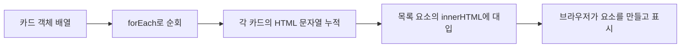
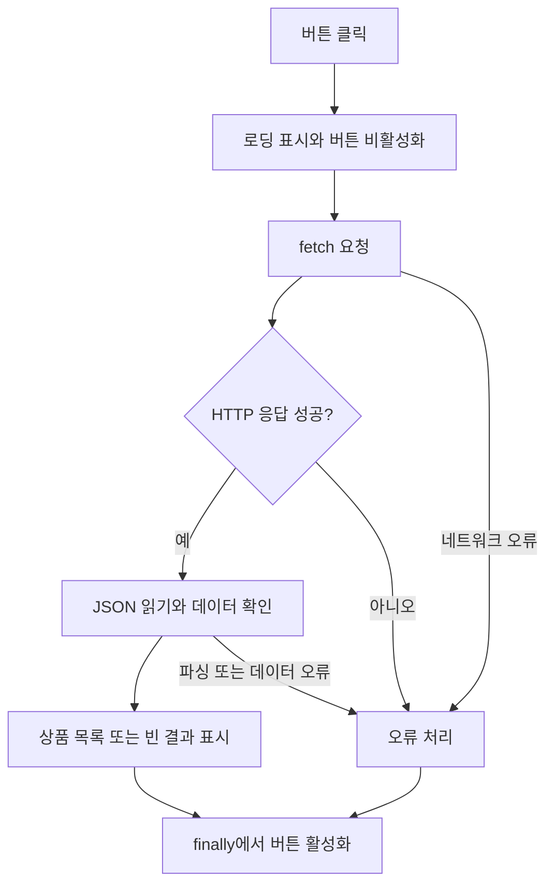
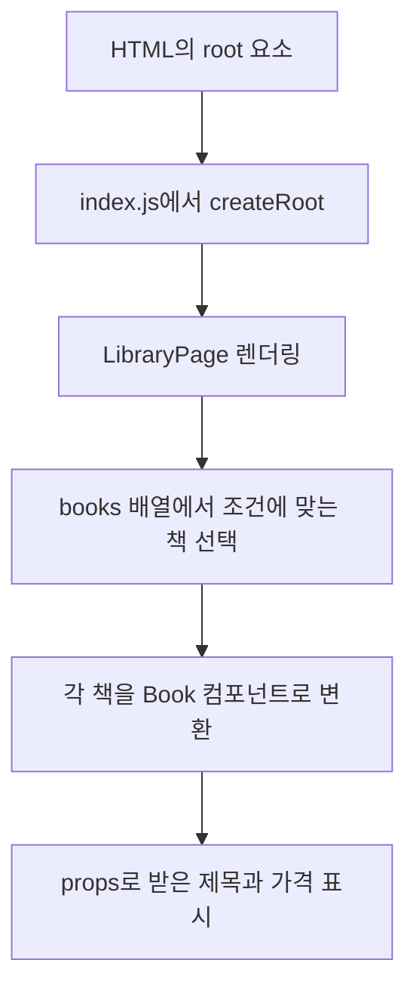

# 2026-11-08 TIL | 웹 기초에서 React 컴포넌트와 스타일링까지 연결하기

## 1. 오늘 공부한 내용

오늘은 프론트엔드 PART 1 교안으로 HTML, CSS, JavaScript의 기본기를 다시 정리하고, PART 2의 React 시작과 컴포넌트 스타일링까지 이어서 공부했다. 최근에는 Next.js에서 로그인, 게시글, 캐싱, 알림처럼 여러 기능이 연결되는 코드를 봤는데, 이번에는 그 아래에 있는 브라우저의 기본 동작부터 컴포넌트를 나누는 방식까지 돌아봤다.

특히 폼 부분을 읽으면서 이전에 정리한 게시글 검색이 생각났다. 검색 버튼에 별도의 클릭 함수를 붙이지 않아도 검색어가 URL로 전달되는 이유는 HTML 폼에 이미 그 기능이 있기 때문이었다. 댓글 수를 누르면 댓글 영역이 열리던 코드도 `label`, `input`, CSS 상태 선택자로 연결해서 볼 수 있었다.

**React나 Next.js를 사용해도 HTML의 역할, CSS의 적용 규칙, JavaScript의 실행 흐름은 계속 필요하다.** 배열을 책 목록으로 만들고 버튼과 입력창을 컴포넌트로 분리하는 과정에서도 앞에서 본 기초가 그대로 이어졌다.

- HTML 문서 구조와 시맨틱 태그
- 폼 데이터 전송과 `id`, `name`, `value`의 차이
- CSS 선택자, 박스 모델, 레이아웃과 반응형
- JavaScript 변수·함수·배열 처리
- DOM 생성, 이벤트, 입력값 검증
- Promise, `async/await`, fetch와 axios
- React 렌더링의 출발점, JSX, 컴포넌트와 props
- `filter`·`map`으로 책 목록 만들기와 `key`
- styled-components로 공통 버튼·입력창 스타일링하기
- MUI·React Bootstrap과 공통 UI 컴포넌트
- 기존 React·Next.js 코드와 연결되는 부분

---

## 2. 이전 학습과 연결하기

예전에 작성한 TIL을 다시 보니 오늘 공부한 내용이 여러 번 등장했다.

| 이전 기록 | 오늘 다시 연결한 내용 |
|---|---|
| [10/21 — HTTP와 프론트엔드](2026-10-21.md) | 요청·응답, HTTP 메서드, HTML·CSS·JavaScript의 역할 |
| [10/27 — 웹 개발 기초](2026-10-27.md) | 시맨틱 태그, 박스 모델, DOM, Network 탭 |
| [10/28 — HTML과 JavaScript](2026-10-28.md) | 구조를 먼저 설계하기, 로그인 폼, `querySelector`와 `.value` |
| [11/05 — 게시글 CRUD](2026-11-05.md) | `FormData`, HTML 정제, `useOptimistic` |
| [11/06 — 검색과 SSE](2026-11-06.md) | GET 검색 폼, 댓글 체크박스, 비동기 조회와 이벤트 연결 |

10월 28일에는 강사님이 말씀하신 **HTML 요소의 역할을 먼저 생각하고 구조를 잡는 것**을 중요하게 적어 두었다. 오늘 폼과 이벤트 처리를 다시 보니 그 말이 더 구체적으로 연결됐다.

버튼처럼 보이는 `div`를 만들고 모든 동작을 JavaScript로 붙이기 전에, `button`이나 `form`이 원래 제공하는 기능을 먼저 확인해야 한다. 구조를 제대로 잡으면 직접 작성할 코드도 줄어든다.

---

## 3. HTML — 모양보다 의미와 구조를 먼저 정하기

### 3.1 기본 골격을 다시 읽어 보기

```html
<!DOCTYPE html>
<html lang="ko">
  <head>
    <meta charset="UTF-8">
    <meta name="viewport" content="width=device-width, initial-scale=1.0">
    <title>오늘의 학습 기록</title>
    <link rel="stylesheet" href="./style.css">
  </head>
  <body>
    <header><h1>학습 기록</h1></header>
    <main>
      <article>
        <h2>웹 표준 기초 복습</h2>
        <p>HTML, CSS, JavaScript의 역할을 정리한다.</p>
      </article>
    </main>
  </body>
</html>
```

기본 구조를 복습하기 위해 내용을 간단히 바꾼 예시다.

`head`에는 문자 인코딩, 제목, 스타일시트 같은 문서 정보를 넣고, `body`에는 실제 콘텐츠를 넣는다. `lang="ko"`는 문서의 언어를 전달한다. `viewport`는 모바일 표시의 출발점이지만, 이것만 넣는다고 레이아웃이 자동으로 반응형이 되는 것은 아니다.

`<!DOCTYPE html>`도 장식처럼 붙이는 문장이 아니다. 브라우저가 표준 모드로 문서를 처리하도록 하는 선언이다.

### 3.2 article과 section을 구분하기

`article`은 게시글이나 기사처럼 독립적으로 읽을 수 있는 콘텐츠에 어울린다. `section`은 관련된 내용을 하나의 주제로 묶는 영역이다. 별도의 의미 없이 스타일이나 배치를 위해 묶어야 한다면 `div`를 사용할 수 있다.

이전 게시글 카드에서 사용한 `article`도 단순히 `div` 대신 다른 이름을 쓴 것이 아니라, 그 카드가 하나의 게시글이라는 의미를 표현하는 것이다.

제목 태그도 글자 크기로만 선택하면 안 된다. `h1`부터 `h6`까지는 콘텐츠의 제목 계층을 표현하고, 크기와 간격은 CSS로 조절하는 편이 역할에 맞다.

### 3.3 기본 태그에서 놓치지 않을 부분

| 요소 | 다시 정리한 용도 |
|---|---|
| `a href="#notice"` | 같은 문서의 `id="notice"` 위치로 이동 |
| `ul`, `ol`, `li` | 순서 없는 목록과 순서 있는 목록 |
| `table`, `th`, `td` | 행·열 관계가 있는 데이터 표현 |
| `rowspan`, `colspan` | 세로 셀 병합과 가로 셀 병합 |
| `img`의 `alt` | 이미지의 의미를 대체하는 텍스트 |
| `video`, `audio`의 `controls` | 기본 재생 조작 UI 제공 |
| `div`, `span` | 영역을 묶는 일반 요소와 문장 안의 일반 요소 |

표를 화면 배치용으로 쓰는 것과 데이터를 표로 표현하는 것은 다르다. 페이지 배치는 CSS로 처리하고, 수업 일정처럼 행과 열의 관계가 필요한 내용에 표를 쓰는 것이 맞다.

`alt`는 파일명을 적는 칸으로 생각하지 않으려고 한다. 이미지가 전달하는 내용을 적되, 의미 없는 장식 이미지라면 `alt=""`로 구분할 수 있다.

---

## 4. 폼 — 입력창을 만드는 것과 데이터를 보내는 것

### 4.1 id, name, value의 역할

배송 예약 예제의 핵심 구조를 줄이면 다음과 같다. 라벨 연결과 필수 입력 조건을 함께 넣어 정리했다.

```html
<form action="./thanks.html" method="get">
  <fieldset>
    <legend>배송 예약</legend>
    <label for="product-name">주문 상품</label>
    <input id="product-name" name="product" type="text" required>
    <label for="delivery-date">배송일</label>
    <input id="delivery-date" name="date" type="date" required>
    <button type="submit">예약</button>
    <button type="reset">초기화</button>
  </fieldset>
</form>
```

| 속성 | 역할 |
|---|---|
| `action` | 폼을 보낼 주소 |
| `method` | 전송 방식 |
| `id` | 문서 안의 요소 식별, 라벨 연결 |
| `name` | 전송할 데이터의 키 |
| `value` | 입력 요소의 값. JavaScript의 `.value`로 현재 값을 읽을 수 있음 |

`id`가 있어도 `name`이 없으면 일반적인 폼 제출에 그 입력값이 포함되지 않는다. 서버가 받을 이름은 `name`이다.

예를 들어 상품에 `book`, 날짜에 `2026-11-10`을 입력하면 GET 제출은 `thanks.html?product=book&date=2026-11-10`과 같은 형태가 된다. 다만 이 주소로 이동하는 것과 예약 정보를 DB에 저장하는 것은 별개다. 저장하려면 요청을 처리하는 서버 기능이 필요하다.

### 4.2 이전의 검색 폼이 생각난 부분

11월 6일 TIL에서 정리했던 검색 폼도 같은 원리다. 스타일을 제외하면 다음처럼 읽을 수 있다.

```tsx
<form action="/posts">
  <input type="hidden" name="sort" value={sortOrder} />
  <input name="q" defaultValue={keyword} maxLength={100} />
  <button type="submit">검색</button>
</form>
```

`method`를 생략했으므로 GET으로 제출된다. 브라우저가 `sort`와 `q`를 URL 쿼리에 담고, 서버에서는 그 조건으로 게시글을 조회한다.

11월 5일에 봤던 `formData.get("body")`도 여기서 이어진다. 폼에 들어 있는 `name="body"`와 서버에서 꺼내는 키가 연결되는 것이다.

### 4.3 POST와 password가 보안을 대신하지는 않는다

GET은 검색 조건처럼 URL에 표현할 조회에 적합하다. 비밀번호처럼 민감한 값을 URL에 넣으면 주소 기록이나 로그 등에 남을 수 있으므로 로그인에서는 POST 본문과 HTTPS를 사용한다.

POST는 데이터를 본문에 담는 방식이고, HTTPS는 전송 구간을 암호화하는 역할이다. `type="password"` 역시 입력 문자를 화면에서 가릴 뿐, 암호화해 보내는 기능은 아니다.

### 4.4 브라우저가 기본으로 처리하는 기능

`label`의 `for`와 입력창의 `id`를 맞추면 라벨을 눌러 입력창에 포커스를 줄 수 있다. 체크박스라면 라벨 클릭으로 체크 상태를 바꿀 수 있다. JSX에서는 `for` 대신 `htmlFor`를 쓴다.

이전에 댓글 펼치기에서 `htmlFor`에 게시글별 체크박스 ID를 연결했던 것도 이 원리다. 카드마다 다른 ID를 사용하므로 자기 카드의 체크박스를 조작할 수 있다.

입력 속성도 비슷해 보여서 구분해 두었다.

| 구분 | 동작 |
|---|---|
| `readonly` | 지원되는 입력 요소에서 수정은 막지만 값은 제출 가능 |
| `disabled` | 비활성화하며 일반적인 폼 제출에서 제외 |
| `required` | 브라우저가 필수 입력 검사 |
| `placeholder` | 입력 전 안내 문구. 라벨을 대신하지 않음 |
| 라디오 버튼의 같은 `name` | 하나만 선택하는 그룹 구성 |
| 체크되지 않은 체크박스 | 일반적인 폼 제출에서 값이 빠짐 |

브라우저의 검사는 입력을 돕는 기능이다. 이전에 검색어를 서버에서 다시 정규화했던 것처럼, 서버에서도 값과 권한을 확인해야 한다.

---

## 5. CSS — 어떤 요소를 선택하고 어떤 규칙을 적용하는가

### 5.1 선택자의 관계를 읽기

```css
.tour a { color: navy; }
.tour > a { text-decoration: none; }
h2 + p { margin-top: 0; }
input:checked { accent-color: blue; }
```

`.tour a`는 안쪽 깊이에 상관없이 후손 링크를 고른다. `.tour > a`는 바로 아래 자식 링크만 고른다. `h2 + p`는 같은 부모 아래에서 `h2` 바로 다음에 있는 `p`를 선택한다.

10월 28일에 정리한 `document.querySelector(".input01")`도 CSS 선택자 문법으로 요소를 찾는다. 선택자는 스타일을 줄 때만 쓰는 문법이 아니었다.

이전에 댓글 토글의 `:checked`도 같은 맥락이다. Tailwind 클래스가 길어 보여도 결국에는 체크된 요소를 조건으로 CSS를 적용하는 구조다.

### 5.2 나중에 쓴 CSS가 무조건 이기지는 않는다

같은 출처·중요도·캐스케이드 레이어 조건에서 일반 선언끼리 비교하면 ID, 클래스·속성·가상 클래스, 태그 순으로 명시도를 따져 본다. 명시도가 같고 다른 우선 조건도 같을 때 뒤에 작성한 선언이 적용된다.

`!important`를 붙이는 일과 선택자의 명시도를 높이는 일은 다르다. 스타일이 적용되지 않는다고 바로 `!important`를 붙이기보다 개발자 도구에서 어떤 규칙이 덮어쓰는지 먼저 확인하려고 한다. [MDN 선택자 명시도](https://developer.mozilla.org/en-US/docs/Web/CSS/CSS_cascade/Specificity)

### 5.3 박스 크기를 실제 숫자로 계산하기

```css
.card {
  width: 200px;
  padding: 20px;
  border: 2px solid #ddd;
  margin: 10px;
}
```

`box-sizing: content-box`라면 테두리까지의 너비는 `200 + 40 + 4 = 244px`이다. 여기에 좌우 마진까지 포함한 가로 공간은 264px이 된다.

```css
.card {
  box-sizing: border-box;
}
```

`border-box`로 바꾸면 지정한 200px 안에 패딩과 테두리가 포함된다. 같은 조건에서 내용 영역은 156px이 되고, 마진은 여전히 바깥에 남는다.

10월 27일에도 박스 모델을 정리했지만, 이번에는 “200px을 줬는데 왜 더 크게 보이지?”라는 상황을 숫자로 설명할 수 있도록 복습했다. Tailwind의 패딩·테두리·너비 클래스도 결국 이 계산과 연결된다.

### 5.4 배치와 반응형

`div`는 기본적으로 블록, `span`은 인라인으로 배치된다. 다만 CSS의 `display`로 배치 방식은 달라질 수 있다. 태그의 의미와 배치 방식은 따로 생각해야 한다.

교안의 카드 예제는 `inline-block`으로 가로 배치한다. Flexbox나 Grid로도 배치할 수 있지만, 오늘은 먼저 기존 예제가 어떤 방식으로 공간을 차지하는지 읽었다. `float`는 요소 옆으로 내용이 흐르게 하는 속성이며, 떠 있는 자식과 부모 높이의 관계도 살펴볼 필요가 있다.

`position: relative`는 자신의 원래 위치를 기준으로 이동하고, `absolute`는 일반적인 문서 흐름에서 빠진다. 보통 가까운 위치 지정 조상을 기준으로 배치하므로, 요소가 엉뚱한 곳에 보이면 기준이 되는 조상부터 확인해야 한다.

미디어쿼리는 조건에 따라 CSS를 적용한다.

```css
@media screen and (min-width: 768px) and (max-width: 1023px) {
  .container {
    width: 100%;
    padding: 16px;
    box-sizing: border-box;
  }
}
```

이 예시는 해당 너비 구간에서만 적용된다. 반응형을 확인할 때는 그 구간 안쪽뿐 아니라 경계 바로 전후도 비교해 보는 것이 좋겠다.

---

## 6. JavaScript — React에서 사용하던 문법 다시 보기

### 6.1 const는 객체 내부까지 고정하지 않는다

```javascript
const user = { name: "seokjoon", studying: true };
user.studying = false; // 객체 속성 변경은 가능

const topics = ["HTML", "CSS"];
topics.push("JavaScript"); // 배열 내용 변경도 가능
```

`const`가 막는 것은 변수에 다른 값을 다시 대입하는 것이다. 객체 속성이나 배열 요소까지 자동으로 읽기 전용이 되지는 않는다.

그래서 `const`로 만든 배열이라고 React state를 직접 변경해도 되는 것은 아니다. 변수 선언 규칙과 상태 업데이트 규칙을 구분해야 한다.

### 6.2 입력값의 타입과 엄격한 비교

```javascript
const value = "10";

console.log(value === 10);         // false
console.log(Number(value) === 10); // true
```

문자열 입력을 숫자와 비교하려면 변환할 시점을 명확히 정해야 한다. `==`의 암묵적인 타입 변환에 기대기보다 `===`로 비교하고 필요한 변환을 직접 하는 쪽이 코드를 읽기 쉽다.

자판기 예제의 `parseInt()`와 `switch`도 이런 흐름이다. 입력을 숫자로 바꾸고 해당 `case`를 실행하며, `break`가 없으면 다음 분기로 이어질 수 있다. 실제 입력에서는 취소나 숫자가 아닌 값도 따로 처리해야 한다.

### 6.3 함수 전달과 함수 호출

```javascript
const handleClick = () => {
  console.log("버튼 클릭");
};

button.addEventListener("click", handleClick);
```

`button` 요소에 핸들러를 연결하는 예시다. `handleClick`을 넘기는 것은 나중에 호출할 함수를 등록하는 일이다. `handleClick()`을 쓰면 그 자리에서 호출한 결과를 넘기게 된다.

React에서 사용하는 `onClick={handleClick}`도 함수가 값이라는 같은 성질을 이용한다. 화살표 함수는 일반 함수와 `this` 처리 등에 차이가 있으므로 모든 상황에서 그대로 교체할 수 있다고 생각하지는 않으려고 한다.

### 6.4 map, filter, forEach

```javascript
const numbers = [1, 2, 3, 4, 5, 6, 7];
const result = numbers
  .filter((value) => value % 2 === 0)
  .map((value) => value ** 2);

console.log(result); // [4, 16, 36]
```

`filter`로 짝수만 남긴 새 배열을 만들고, `map`으로 각 값을 제곱한 새 배열을 만든다. `forEach`는 요소별 작업을 실행하지만 결과 배열을 반환하지 않는다.

React에서 `items.map(...)`으로 목록을 만드는 이유도 여기에 있다. JSX 요소들의 배열이 필요한데 `forEach`를 사용하면 반환값이 `undefined`다.

`map`과 `filter`가 새 배열을 만든다고 해서 콜백 안에서 객체를 바꿔도 원본이 항상 안전한 것은 아니다. 배열 안의 객체 참조는 공유될 수 있으므로 객체 속성을 직접 변경하는 코드는 따로 주의해야 한다.

---

## 7. DOM — 데이터를 화면으로 바꾸는 과정

### 7.1 요소를 찾는 것과 만드는 것

`querySelector`는 조건에 맞는 첫 요소를 찾고, `querySelectorAll`은 일치하는 요소들을 담은 목록을 반환한다. 찾지 못한 `querySelector`의 결과는 `null`이므로 바로 `.value`나 `.textContent`를 사용하면 오류가 날 수 있다.

10월 28일 로그인 코드에서 입력값을 읽었던 것도 `요소 찾기 → .value 읽기`의 순서였다. 스크립트가 실행될 때 해당 요소가 이미 만들어져 있는지도 확인해야 한다.

### 7.2 투어 카드 예제의 실행 흐름

교안의 `cardQuiz.html`은 카드 데이터 배열을 순회하며 HTML 문자열을 모으고, 마지막에 `innerHTML`에 한 번 넣는다.



여기서는 객체 하나가 카드 한 장의 재료다. 데이터를 어떤 HTML로 바꿀지 정한 뒤, 완성된 결과를 DOM에 반영한다. 반복문 안에서 매번 기존 DOM을 다시 쓰는 것과 구분해서 읽었다.

### 7.3 textContent와 innerHTML, 그리고 XSS

`textContent`는 문자열을 텍스트로 넣고, `innerHTML`은 문자열을 HTML로 해석한다. 사용자 입력이나 외부 데이터를 그대로 `innerHTML`에 넣으면 의도하지 않은 HTML이나 실행 가능한 코드가 들어갈 수 있다.

이 부분에서 [11월 5일 Quill과 HTML 처리](2026-11-05.md#12-quill-에디터와-html-데이터-처리)가 생각났다. 에디터가 만든 HTML을 표시하려면 정제가 필요하고, React의 `dangerouslySetInnerHTML`도 같은 경계를 주의해야 했다.

일반적인 JSX 텍스트 출력과 HTML 문자열을 직접 삽입하는 것은 다르다. 이름이나 제목처럼 텍스트만 필요하면 굳이 HTML로 해석하지 않는 편이 맞다.

### 7.4 createElement로 조립하는 방식

학생 카드 예제를 이름과 삭제 버튼만 남겨 줄였다. `#container` 요소가 존재하는 페이지에서 실행하는 예시다.

```javascript
const students = [{ name: "홍길동" }, { name: "김학생" }];
const container = document.querySelector("#container");

function renderStudents() {
  if (!container) return;
  container.replaceChildren();

  students.forEach((student, index) => {
    const card = document.createElement("div");
    const name = document.createElement("h3");
    const button = document.createElement("button");

    name.textContent = student.name;
    button.type = "button";
    button.textContent = "삭제";
    button.addEventListener("click", () => {
      students.splice(index, 1);
      renderStudents();
    });

    card.append(name, button);
    container.append(card);
  });
}

renderStudents();
```

실행 순서는 목록 비우기, 배열 순회, 요소 생성, 내용과 이벤트 설정, DOM에 붙이기다. 버튼을 누르면 배열에서 항목을 삭제하고 다시 그린다.

`createElement`만 호출하면 아직 화면에는 보이지 않는다. 문서에 연결된 컨테이너에 붙여야 한다. 또한 화면에서 카드만 제거하고 배열을 그대로 두면 다음 렌더링에서 다시 나타날 수 있다. 데이터와 화면을 함께 생각해야 하는 이유다.

### 7.5 React state로 옮기면 달라지는 부분

위 예제는 일반 배열을 `splice()`로 바꾼 뒤 직접 렌더링 함수를 호출한다. React state에서는 기존 배열을 직접 바꾸는 대신 새 배열로 업데이트한다.

```tsx
setStudents((current) =>
  current.filter((student) => student.id !== targetId),
);
```

이 코드는 `id`가 있는 학생 데이터를 state로 관리한다고 가정한 비교 예시다. 새 상태를 전달하면 React가 그 상태에 맞춰 UI를 계산한다. 배열에서 삭제할 때는 `filter`처럼 새 배열을 만드는 방법을 사용할 수 있다. [React 배열 상태 업데이트](https://react.dev/learn/updating-arrays-in-state)

이전의 좋아요 화면도 데이터와 UI를 맞추는 문제였지만, `useOptimistic`은 서버 처리 중 임시 상태를 먼저 보여 준다는 차이가 있었다. 일반 배열을 바꾸고 다시 그리는 예제와 서버 저장까지 완료한 상황을 같은 것으로 생각하면 안 된다.

---

## 8. 이벤트와 입력값 검사

### 8.1 target과 currentTarget

커피 바꾸기 예제는 버튼을 누르면 제목, 이미지, 버튼 문구를 함께 바꾼다. 버튼 문구로 현재 상태를 판단하는 구조다.

단순한 버튼에서는 `e.target`이 버튼이지만, 버튼 안의 아이콘이나 다른 요소를 누르면 그 자식이 `target`일 수 있다. 이벤트 핸들러를 연결한 요소를 가리키는 것은 `currentTarget`이다.

```javascript
button.addEventListener("click", (event) => {
  event.currentTarget.textContent = "다시 보기";
});
```

화면 문구를 상태의 기준으로 삼는 것은 기초 예제에서는 이해하기 쉽다. 이후에는 문구가 바뀌어도 로직이 흔들리지 않도록 별도의 상태값으로 관리하는 방식도 비교해 보고 싶다.

### 8.2 검증 실패 후에는 다음 처리를 멈추기

폼 검사는 다음 순서로 읽었다.

```text
입력값 읽기 → 빈 값·형식 검사 → 오류 표시 후 return
                         ↓ 통과
                    데이터 구성 → 서버 요청
```

오류 문구만 표시하고 `return`하지 않으면 아래의 요청 코드까지 실행될 수 있다. 입력값을 검사하는 조건과 실패 이후 실행 흐름을 함께 확인해야 한다.

폼의 기본 제출 대신 JavaScript로 요청을 처리한다면 `submit` 이벤트에서 `preventDefault()`로 기본 이동을 막는 방식도 사용할 수 있다. 반면 이전의 GET 검색 폼은 기본 제출 자체가 목적이므로 무조건 막을 필요가 없다.

---

## 9. 비동기 처리 — 요청을 보낸 시점과 결과를 쓰는 시점

### 9.1 Promise와 async/await

Promise는 아직 결과를 기다리는 `pending`, 성공한 `fulfilled`, 실패한 `rejected` 상태로 나누어 이해했다. 교안의 예제는 `setTimeout`으로 기다리는 상황을 만들고, `reject()`를 호출해 `catch`로 이어지게 한다.

`await`는 해당 비동기 함수의 다음 처리를 결과가 준비될 때까지 미룬다. 브라우저 전체를 멈추는 것은 아니다. 다만 비동기 함수 안에서도 오래 걸리는 동기 계산을 실행하면 화면을 막을 수 있으므로, `async`를 붙이는 것만으로 모든 작업이 가벼워지지는 않는다.

### 9.2 fetch 응답과 JSON 본문을 구분하기

```javascript
const response = await fetch("https://fakestoreapi.com/products");
const products = await response.json();
```

비동기 함수 안에서 사용하는 부분 코드다. 첫 번째 결과는 상품 배열 자체가 아니라 HTTP 응답을 다루는 `Response`다. 두 번째 줄에서 본문을 읽고 JSON을 JavaScript 값으로 파싱한다. 그래서 두 단계 모두 기다리는 코드가 들어간다.

### 9.3 HTTP 오류를 직접 확인하기

**fetch는 서버가 404나 500을 응답했다는 이유만으로 reject하지 않는다.** 응답을 받은 뒤 `response.ok`를 확인하고 필요하면 오류를 발생시켜야 한다. 네트워크 오류와 HTTP 실패 응답을 구분해서 보는 것이 중요하다. [MDN Fetch 사용](https://developer.mozilla.org/en-US/docs/Web/API/Fetch_API/Using_Fetch)

상품 조회 예제에 상태 확인과 텍스트 출력을 반영해 정리했다. 아래 코드는 `#load-products`, `#products`, `#status` 요소가 있는 페이지에서 실행하며, API가 `title`과 `price`를 가진 상품 배열을 반환한다고 가정한다.

```javascript
const button = document.querySelector("#load-products");
const list = document.querySelector("#products");
const status = document.querySelector("#status");

if (button && list && status) {
  button.addEventListener("click", async () => {
    button.disabled = true;
    status.textContent = "불러오는 중...";
    list.replaceChildren();

    try {
      const response = await fetch("https://fakestoreapi.com/products");
      if (!response.ok) {
        throw new Error(`HTTP ${response.status}`);
      }

      const products = await response.json();
      if (!Array.isArray(products)) {
        throw new Error("상품 목록 형식이 올바르지 않습니다.");
      }

      products.forEach((product) => {
        const item = document.createElement("li");
        item.textContent = `${product.title} - ${product.price}`;
        list.append(item);
      });
      status.textContent = products.length ? "조회 완료" : "상품이 없습니다.";
    } catch (error) {
      status.textContent = "상품을 불러오지 못했습니다.";
      console.error(error);
    } finally {
      button.disabled = false;
    }
  });
}
```

요청을 시작할 때 버튼을 비활성화하고, 성공하면 목록을 만든다. HTTP 상태가 실패이거나 JSON 처리 중 오류가 발생하면 `catch`에서 안내한다. `finally`에서는 성공 여부에 관계없이 버튼을 다시 활성화한다.

이것은 교안 예제를 바탕으로 로딩·빈 결과·실패 처리를 보충한 코드다. 외부 API의 각 상품 필드까지 완전히 검증하는 코드는 아니므로 실제 서비스에서는 응답 형태 검사도 더 구체적으로 해야 한다.



### 9.4 axios와 비교하기

axios를 사용할 수 있도록 설치하거나 로드한 상태에서는 비동기 함수 안에서 다음처럼 데이터를 꺼낸다.

```javascript
const response = await axios.get("https://fakestoreapi.com/products");
const products = response.data;
```

| 구분 | fetch | axios |
|---|---|---|
| 제공 방식 | 브라우저 내장 API | 별도 라이브러리 |
| JSON 응답 읽기 | `await response.json()` | 일반적인 JSON 응답은 `response.data` |
| HTTP 실패 상태 | 직접 `response.ok` 검사 | 기본 설정에서 2xx 밖의 상태를 오류로 처리 |
| 공통점 | Promise 기반 | Promise 기반 |

axios의 상태 처리 기준은 `validateStatus` 설정으로 바꿀 수 있다. 따라서 어떤 응답이 `catch`로 가는지 볼 때는 라이브러리 이름뿐 아니라 설정도 확인해야 한다. [Axios 오류 처리](https://axios-http.com/docs/handling_errors)

### 9.5 이전 Network 탭 복습과 연결

10월 27일 TIL에 Network 탭을 확인하는 습관이 중요하다고 적어 둔 것이 생각났다. 오늘은 확인할 항목을 더 구체적으로 정리할 수 있었다.

요청이 실제로 나갔는지, 메서드와 URL이 맞는지, 상태 코드가 무엇인지, 응답 본문이 예상한 JSON인지 순서대로 보면 된다. 화면에 목록이 안 보인다는 결과만으로 서버 오류라고 단정하지 않고, 응답을 받은 뒤 DOM에 반영하는 단계도 확인해야 한다.

---

## 10. TypeScript와 연결해서 보기

PART 1 마지막에는 기본 타입, 배열, 튜플, 함수의 매개변수·반환 타입, `any`와 `unknown`이 나온다.

```typescript
type Product = {
  id: number;
  title: string;
  price: number;
};

function formatProduct(product: Product): string {
  return `${product.title} - ${product.price}`;
}
```

이전에 Next.js 코드에서 봤던 타입도 함수가 어떤 값을 받고 반환하는지 드러내는 역할이었다. 필드 이름이나 값의 종류를 잘못 사용하는 실수를 개발 중에 찾는 데 도움이 된다.

다만 TypeScript 타입을 적었다고 서버 응답이 런타임에 자동 검증되는 것은 아니다. `any`는 검사를 쉽게 통과시키지만 잘못된 사용을 잡기 어렵고, `unknown`은 사용하기 전에 값을 좁혀 확인하도록 한다.

---

## 11. React — 데이터를 컴포넌트로 표현하기

### 11.1 DOM을 직접 조립하던 코드와 비교하기

앞의 학생 카드 예제에서는 요소를 만들고, 내용을 넣고, 이벤트를 연결한 뒤 컨테이너에 붙였다. React에서는 같은 작업을 JSX로 표현한다. 어떤 데이터를 어떤 구조로 보여 줄지 작성하면 React가 렌더링 결과를 DOM에 반영한다.

이 차이를 선언형 UI라는 말과 연결해서 이해했다. 다만 일반 변수를 바꾸기만 하면 React가 알아서 다시 렌더링하는 것은 아니다. 이전에 봤던 state 업데이트처럼 React에 변경을 전달하는 과정이 필요하다. 오늘 PART 2에서 정리한 범위는 컴포넌트의 구성과 스타일링까지이고, 상태 업데이트는 기존 학습 내용과 비교하는 기준으로만 연결했다.

### 11.2 화면이 시작되는 지점

`src/index.js`에서는 HTML의 `#root`를 찾아 React 루트를 만들고, 그 안에 `LibraryPage`를 렌더링한다. 스타일 import를 제외한 핵심 부분은 다음과 같다.

```jsx
import ReactDOM from "react-dom/client";
import LibraryPage from "./pages/test/LibraryPage";

const root = ReactDOM.createRoot(document.getElementById("root"));
root.render(<LibraryPage />);
```

`LibraryPage`는 페이지 전체를 구성하고, 그 안의 `Book`은 책 한 권의 UI를 담당한다. 파일을 나누는 기준을 단순히 코드 길이로만 보기보다, 각각 어떤 역할을 맡는지 먼저 생각해야 한다.



프로젝트마다 진입 파일 이름은 다를 수 있다. 여기서는 `index.js`이고, Next.js에서는 프레임워크가 진입과 라우팅 구조를 관리한다. 이전 Next.js 프로젝트에 이 파일을 그대로 추가해야 한다는 뜻은 아니다.

교안의 실행 절차는 CRA 기준이다. 예제를 읽을 때의 프로젝트 구조로 이해하고, 새 프로젝트를 만들 때는 [React 시작 안내](https://react.dev/learn/creating-a-react-app)를 기준으로 구성을 확인하려고 한다.

### 11.3 JSX는 HTML과 비슷하지만 JavaScript 안에서 사용한다

| 작성할 때 확인할 부분 | 예시 |
|---|---|
| 컴포넌트 이름은 대문자로 시작 | `<Book />` |
| 여러 요소는 하나로 묶어서 반환 | `<article>...</article>` 또는 `<>...</>` |
| CSS 클래스는 `className` | `<div className="book">` |
| JavaScript 표현식은 중괄호 안에 작성 | `<h3>{bookName}</h3>` |
| 인라인 스타일은 객체로 전달 | `style={{ marginTop: 16 }}` |
| 태그는 닫기 | `<input />`, `` |

`style`에서 중괄호가 두 겹인 것은 첫 번째 중괄호가 JavaScript 표현식을 넣는 자리이고, 그 안에 객체를 작성하기 때문이다. 속성 이름도 `margin-top` 대신 `marginTop`처럼 쓴다.

또한 `export default Book`으로 내보낸 컴포넌트는 `import Book from "..."`으로 가져오고, 이름을 붙여 내보낸 `export function Book()`은 `import { Book } from "..."`으로 가져온다. JSX 문제가 아니라 모듈의 내보내기 방식과 맞춰야 하는 부분이다.

### 11.4 props로 책 한 권의 데이터를 전달하기

책 목록 예제를 제목과 가격 중심으로 줄이고, 항목을 구분할 고유 ID를 붙여 정리했다. 아래 파일 경로는 이 복습 예시의 구성이다.

```jsx
// src/components/Book.jsx
export default function Book({ bookName, price }) {
  return (
    <article>
      <h3>{bookName}</h3>
      <p>{price.toLocaleString("ko-KR")}원</p>
    </article>
  );
}
```

```jsx
// src/pages/test/LibraryPage.jsx
import Book from "../../components/Book";

const books = [
  { id: "java", category: "it", bookName: "Java 기초", price: 10000 },
  { id: "vietnamese", category: "lang", bookName: "베트남어 기초", price: 10000 },
  { id: "english", category: "lang", bookName: "영어 기초", price: 10000 },
];

export default function LibraryPage() {
  return (
    <section>
      <h2>어학 도서</h2>
      {books
        .filter((book) => book.category === "lang")
        .map((book) => (
          <Book key={book.id} bookName={book.bookName} price={book.price} />
        ))}
    </section>
  );
}
```

먼저 `filter`가 어학 도서만 남긴다. 다음으로 `map`이 각 책 객체를 `<Book />`으로 바꾼다. 부모가 `bookName`과 `price`를 전달하면 자식은 props 객체에서 두 값을 꺼내 표시한다. 앞에서 숫자 배열을 걸러 제곱했던 코드와 같은 문법인데, 이번에는 결과가 JSX 요소들의 배열이다.

props는 부모가 전달한 입력값이다. 자식이 받은 값을 직접 바꾸는 방식으로 부모 데이터를 수정하면 안 된다. 동작이 필요하면 부모가 함수를 전달하고, 자식이 적절한 시점에 호출하도록 구성할 수 있다.

### 11.5 key는 목록에서 항목을 구분하는 기준

책 목록 예제에는 배열 인덱스를 `key`로 쓰는 코드가 있다. 위 복습 코드에서는 책의 고유 ID로 바꿨다. 항목이 추가·삭제되거나 순서가 달라지면 인덱스가 바뀌기 때문에 같은 책을 안정적으로 식별하기 어렵기 때문이다.

`key`는 형제 목록 안에서 고유하고, 같은 항목에 대해 안정적으로 유지되어야 한다. React가 항목을 구분하는 값이므로 `Book` 내부에서 일반 props처럼 `key`를 꺼낼 수는 없다. 자식에서도 ID가 필요하면 `bookId={book.id}`처럼 별도로 전달해야 한다.

---

## 12. styled-components — 스타일을 컴포넌트와 함께 묶기

### 12.1 CSS가 없어지는 것은 아니다

| 방식 | 스타일을 두는 곳과 특징 |
|---|---|
| 일반 CSS import | CSS 파일의 클래스·선택자로 적용. 일반 CSS를 import했다고 자동으로 해당 컴포넌트에만 제한되지는 않음 |
| 인라인 스타일 | JSX의 `style` 객체로 전달 |
| styled-components | JavaScript 파일에서 스타일을 정의하고 컴포넌트로 사용 |
| MUI·React Bootstrap | 미리 만들어진 UI 컴포넌트를 가져와 조합 |

10월 27일에 적었던 Tailwind의 `p-4`는 클래스 이름으로 패딩을 지정했다. styled-components에서는 컴포넌트 정의 안에 `padding: 16px` 같은 CSS를 작성한다. 스타일을 작성하고 관리하는 방식은 다르지만, 최종적으로 브라우저에 적용되는 패딩과 박스 모델의 원리는 같다.

styled-components는 생성한 클래스 이름을 통해 스타일 충돌을 줄여 준다. 그렇다고 CSS의 상속이나 전역 스타일의 영향까지 모두 사라지는 것은 아니다.

### 12.2 공통 버튼 만들기

`styled-components`를 설치한 프로젝트에서 `styled`를 가져온다. 버튼 예제에 폼 안에서의 의도치 않은 제출을 막는 기본 `type`과 비활성화 스타일을 보충했다.

```jsx
// src/components/Button.jsx
import styled from "styled-components";

const StyledButton = styled.button`
  padding: 8px 16px;
  font-size: 16px;
  border-width: 1px;
  border-radius: 8px;
  cursor: pointer;

  &:disabled {
    cursor: not-allowed;
    opacity: 0.5;
  }
`;

export default function Button({ title, onClick, disabled = false, type = "button" }) {
  return (
    <StyledButton type={type} onClick={onClick} disabled={disabled}>
      {title}
    </StyledButton>
  );
}
```

`styled.button`으로 만든 `StyledButton`은 스타일을 가진 버튼 컴포넌트다. 바깥의 `Button`은 사용할 props를 정리하고, 실제 버튼으로 전달하는 역할을 한다.

부모가 `disabled`를 보냈더라도 내부에서 전달하지 않으면 실제 버튼은 비활성화되지 않는다. `onClick`도 마찬가지다. 공통 컴포넌트를 만들 때는 겉에서 받은 props가 최종 HTML 요소까지 어떻게 이어지는지 확인해야 한다.

```jsx
// src/pages/test/ButtonPage.jsx
import Button from "../../components/Button";

export default function ButtonPage() {
  const handleSave = () => window.alert("저장 버튼 클릭");
  const handleList = () => window.alert("목록 버튼 클릭");

  return (
    <div>
      <Button title="저장" onClick={handleSave} />
      <Button title="목록" onClick={handleList} />
    </div>
  );
}
```

버튼 모양은 공유하고 제목과 동작만 다르게 전달한다. 이 예제의 저장과 목록 버튼은 알림창을 띄우는 동작만 한다. 실제 저장 요청이나 페이지 이동은 별도의 로직이 필요하다.

`onClick={handleSave}`는 함수를 전달하고, `onClick={handleSave()}`는 렌더링 중에 함수를 호출한다. 앞의 `addEventListener`에서 확인한 함수 전달과 호출의 차이가 여기서 그대로 나왔다. 인자가 필요하면 `onClick={() => handleSelect(book.id)}`처럼 클릭할 때 실행할 함수를 전달할 수 있다.

### 12.3 props에 따라 입력창 높이를 바꾸기

`TextInput.jsx`는 `styled.textarea`를 사용한다. 이름에 Input이 들어가지만 실제로 만들어지는 HTML 요소는 여러 줄을 입력하는 `textarea`다.

높이를 조건에 따라 넣는 핵심 표현은 다음과 같다.

```jsx
const StyledTextArea = styled.textarea`
  width: calc(100% - 32px);
  ${(props) => props.height && `height: ${props.height}px;`}
  padding: 16px;
  font-size: 16px;
  line-height: 20px;
  margin-top: 16px;
`;
```

바깥 템플릿 리터럴의 `${...}` 안에서 함수를 실행해 props를 읽고, 높이가 있으면 `height: 120px;` 같은 CSS 문자열을 만든다. 컴포넌트를 사용할 때 전달한 값이 스타일을 결정하는 흐름이다. 이 조건은 값의 참·거짓을 검사하므로 `height={0}`도 높이 선언을 생략한다는 점은 구분해야 한다.

`width`에서 32px을 빼는 부분은 좌우 패딩 16px씩과 연결해서 볼 수 있다. 다만 실제 바깥 너비에는 테두리와 `box-sizing`도 영향을 준다. 앞에서 복습한 박스 모델이 여기서 다시 필요했다.

스타일에만 쓰는 props를 DOM 속성과 구분하고, 너비 계산을 단순하게 한 복습 코드는 다음과 같다. `$height`는 styled-components의 스타일 전용 props로 사용했다.

```jsx
// src/components/TextInput.jsx
import styled from "styled-components";

const StyledTextArea = styled.textarea`
  box-sizing: border-box;
  width: 100%;
  ${({ $height }) => $height != null && `height: ${$height}px;`}
  padding: 16px;
  font-size: 16px;
  line-height: 20px;
  margin-top: 16px;
`;

export default function TextInput({ height, value, changeHandler, ...rest }) {
  return (
    <StyledTextArea
      {...rest}
      $height={height}
      value={value}
      onChange={changeHandler}
    />
  );
}
```

흐름은 `TextInput`의 `height` → `StyledTextArea`의 `$height` → CSS 높이 선언이다. `$height`는 실제 HTML 속성으로 전달되지 않는다. `$height != null`은 `null`·`undefined`를 제외하므로 0도 값으로 처리한다. 높이는 픽셀 단위의 숫자를 전달하는 것으로 정했다. [styled-components props 처리](https://styled-components.com/docs/api#transient-props)

`value`와 `changeHandler`는 스타일용 props와 역할이 다르다. 부모가 입력값을 관리하는 경우 현재 값과 변경 함수를 각각 `value`, `onChange`로 연결한다. 값을 고정해 표시만 할 때는 `readOnly`를 함께 전달할 수 있다. 상태를 관리하는 전체 구현은 다음 복습에서 이어서 확인하려고 한다.

### 12.4 중첩 선택자도 기존 CSS 규칙으로 읽기

```jsx
const Container = styled.div`
  max-width: 720px;

  & > *:not(:last-child) {
    margin-bottom: 16px;
  }
`;
```

`&`는 현재 컴포넌트를 가리킨다. 바로 아래 모든 자식 중 마지막 자식을 제외한 요소에 아래쪽 간격을 주는 선택자다. 앞의 공백·`>`·가상 클래스 복습과 이어서 읽으면 된다. `&:hover`도 현재 컴포넌트에 마우스를 올린 상태를 나타낸다.

간격을 줄 때는 `margin-bottom`을 써야 한다. 예제에 있는 `margin-down`은 유효한 CSS 속성이 아니므로 적용되지 않는다. 이런 경우에는 스타일이 적용되지 않은 원인을 props 전달뿐 아니라 CSS 속성 이름에서도 찾아야 한다.

또한 `styled(기존컴포넌트)`로 스타일을 입힐 때는 그 컴포넌트가 받은 `className`을 실제 DOM 요소로 전달해야 한다. 감싸기만 하면 어떤 컴포넌트든 자동으로 스타일이 적용된다고 생각하지 않으려고 한다. [styled-components 기본 사용법](https://styled-components.com/docs/basics)

---

## 13. UI 라이브러리 — 가져온 버튼도 공통 인터페이스로 묶기

### 13.1 MUI 버튼을 감싸는 이유

MUI 예제에서는 라이브러리의 버튼을 `InspireButton`으로 한 번 감싼다.

```jsx
// InspireButton.jsx
import Button from "@mui/material/Button";

export default function InspireButton({ onClick, title }) {
  return (
    <Button variant="contained" onClick={onClick}>
      {title}
    </Button>
  );
}
```

페이지에서는 `title`과 `onClick`을 전달하고, MUI의 `variant` 같은 세부 설정은 공통 컴포넌트 안에 둔다. 여러 화면에 같은 설정을 반복하는 대신 한 곳에서 기본 모양을 관리할 수 있다.

나중에 버튼 디자인을 바꿀 때도 이 경계를 두면 수정 범위를 줄일 수 있다. 다만 실제로 필요한 `disabled`, `type` 등의 속성을 빠뜨리지 않도록 공통 컴포넌트가 제공할 기능을 정해야 한다. 앞에서 만든 styled-components 버튼과 같은 문제다.

### 13.2 React Bootstrap은 CSS도 함께 필요하다

React Bootstrap은 컴포넌트를 가져오는 것 외에 Bootstrap CSS를 불러와야 기본 디자인이 적용된다. CSS는 앱 진입 지점에서 한 번 불러오는 식으로 구성할 수 있다.

```jsx
// 앱 진입 지점
import "bootstrap/dist/css/bootstrap.min.css";
```

```jsx
// BootstrapButtons.jsx
import BsButton from "react-bootstrap/Button";

export default function BootstrapButtons() {
  return (
    <div>
      <BsButton variant="primary">저장</BsButton>
      <BsButton variant="danger">삭제</BsButton>
    </div>
  );
}
```

직접 만든 `Button`, MUI의 `Button`, Bootstrap의 `Button`을 같은 파일에서 사용할 때는 이름이 겹칠 수 있다. 위처럼 기본 import의 로컬 이름을 `BsButton`으로 정할 수 있고, named import라면 `import { Button as BsButton } from "react-bootstrap"`으로 별칭을 붙일 수 있다.

라이브러리를 사용해도 버튼의 의미와 이벤트 흐름은 그대로 남는다. 오늘은 여러 방식을 비교했지만, 실제 화면을 만들 때는 프로젝트의 스타일 방식과 공통 컴포넌트 규칙을 먼저 확인하고 맞춰 쓰려고 한다. [React Bootstrap 시작 안내](https://react-bootstrap.github.io/docs/getting-started/introduction/)

---

## 14. 헷갈리기 쉬운 부분 정리

| 개념 | 구분할 내용 |
|---|---|
| `id` / `name` | 문서 안 요소 식별 / 전송할 데이터의 키 |
| GET / POST / HTTPS | URL 쿼리 전송 / 본문 전송 / 전송 구간 암호화 |
| `readonly` / `disabled` | 수정 제한과 제출 가능 / 비활성화와 제출 제외 |
| `margin` / `padding` | 바깥 간격 / 테두리 안쪽 간격 |
| `const` / 불변성 | 변수 재할당 제한 / 데이터 자체를 바꾸지 않는 원칙 |
| `map` / `forEach` | 변환한 배열 반환 / 요소별 작업 수행 |
| `textContent` / `innerHTML` | 텍스트로 처리 / HTML로 해석 |
| `target` / `currentTarget` | 실제 이벤트 발생 요소 / 핸들러가 연결된 요소 |
| HTTP 오류 / 네트워크 오류 | 실패 상태의 응답 수신 / 요청·통신 자체의 실패 |
| TypeScript 타입 / 응답 검증 | 개발 중 정적 검사 / 실행 중 실제 값 검사 |
| props / 일반 변수 변경 | 부모가 전달하는 입력값 / 변경만으로 React 렌더링이 예약되지는 않음 |
| `key` / 일반 props | React가 목록 항목을 식별하는 값 / 자식에게 전달할 데이터 |
| `onClick={fn}` / `onClick={fn()}` | 클릭 시 실행할 함수 전달 / 렌더링 중 즉시 호출 |
| `height` / `$height` | 바깥 컴포넌트의 입력 / 이 복습 코드에서 스타일에만 쓰는 props |
| 컴포넌트 import / CSS import | UI 사용 준비 / 스타일 적용 준비. Bootstrap은 둘 다 확인 |

가장 기억해 둘 부분은 **브라우저에서 화면을 바꾸는 일과 서버에 데이터를 저장하는 일은 별개**라는 점이다. 카드를 DOM에서 지웠다고 DB에서도 지워지는 것은 아니고, GET 폼으로 페이지를 이동했다고 예약이 저장되는 것도 아니다.

---

## 15. 다음에 직접 해볼 작업

먼저 교안의 자기소개 페이지와 배송 예약 폼을 작은 HTML 파일로 다시 작성해 보려고 한다. 시맨틱 태그와 제목 계층을 잡고, 라벨을 눌렀을 때 입력창이 선택되는지 확인하겠다. 같은 입력창에서 `name`을 빼거나 `disabled`와 `readonly`를 바꿨을 때 전달되는 값이 어떻게 달라지는지도 비교해 보고 싶다.

카드 예제는 `content-box`와 `border-box`를 번갈아 적용하면서 개발자 도구의 계산된 너비를 확인하려고 한다. 선택자의 공백과 `>`를 바꾸었을 때 적용 범위가 어떻게 달라지는지도 함께 볼 생각이다.

DOM 실습에서는 투어 카드를 문자열로 만드는 방식과 `createElement`로 조립하는 방식을 각각 작성해 보고 싶다. 삭제 버튼을 붙인 뒤 배열과 화면이 함께 바뀌는지 확인하고, 같은 기능을 React state로 옮겼을 때 직접 DOM을 수정하던 코드가 어떻게 달라지는지도 비교할 예정이다.

비동기 통신은 상품 목록을 fetch로 만든 다음 axios로 바꾸어 볼 생각이다. 성공 응답뿐 아니라 404, 느린 응답, 빈 배열에서 안내 문구와 버튼 상태가 어떻게 바뀌는지 확인하겠다. Network와 Console을 함께 보면서 요청 단계와 화면 출력 단계를 나눠 확인하는 연습을 하려고 한다.

PART 2의 버튼·입력창 연습도 이어서 해보려고 한다. 같은 공통 버튼 두 개에 서로 다른 클릭 함수를 전달하고, 입력창 두 개에는 다른 높이를 전달해 볼 생각이다. 클릭하기 전에 알림이 뜨지 않는지, `disabled`가 실제 버튼에 반영되는지, 높이와 컨테이너 간격이 예상대로 계산되는지 확인하겠다.

추가로 책 목록의 카테고리를 바꾸고 항목 순서를 변경하면서 `filter`, `map`, `key`의 역할을 다시 읽어 볼 예정이다. Tailwind로 작성했던 간단한 버튼과 styled-components 버튼도 나란히 만들어서 같은 CSS를 어떤 위치에서 관리하는지 비교해 보고 싶다. 이후 PART 2의 다음 장인 state·이벤트·effect를 공부할 때는 오늘 만든 입력창의 값이 어떻게 바뀌는지까지 이어서 정리하려고 한다.

---

## 16. 오늘의 회고

최근에 Next.js 기능을 계속 보다가 HTML과 JavaScript 기초를 다시 읽으니, 예전에 적어 둔 내용들이 실제 코드와 연결됐다.

폼의 `name`은 서버에서 읽는 데이터의 키였고, 라벨과 체크박스의 연결은 댓글을 펼치는 기능에도 쓰였다. `map`은 단순한 배열 문법이 아니라 목록을 만드는 도구였고, DOM 예제의 데이터 변경과 다시 그리기는 React 상태 업데이트를 비교하는 기준이 됐다.

특히 fetch가 404 응답에서도 바로 `catch`로 가지 않는다는 부분은 기억해 두려고 한다. 요청을 보냈다는 것, 응답을 받았다는 것, 정상 데이터를 화면에 표시했다는 것은 각각 다른 단계였다.

React 부분까지 이어서 보니 `filter`와 `map`이 책 목록을 만드는 코드로 연결됐고, CSS의 패딩과 너비 계산은 `TextInput`을 읽는 데 그대로 필요했다. 새로운 라이브러리를 사용한다고 앞에서 배운 개념이 없어지는 것은 아니었다.

공통 버튼은 모양만 묶는 코드로 보기 쉬운데, 실제로는 제목·클릭 함수·비활성화 여부가 안쪽 요소까지 전달되는 구조도 중요했다. 앞으로 컴포넌트 코드를 볼 때는 겉에서 어떤 props를 받는지와 최종 HTML 요소에 무엇을 넘기는지를 함께 확인하려고 한다.

기초를 복습할 때도 정의만 외우기보다 “이전에 본 코드에서 어디에 쓰였는가”를 같이 생각하는 편이 도움이 된다. 다음에는 작은 예제를 직접 바꿔 가며 각 단계의 동작을 확인해 보고 싶다.

**오늘의 한 줄 정리**

HTML·CSS·JavaScript의 기본 동작이 React의 목록 렌더링, props 전달, 컴포넌트 스타일링으로 어떻게 이어지는지 정리했다.

---

## 17. 참고 자료

- LG CNS AM Inspire Camp 프론트엔드 교안 PART 1 — 웹 표준 기초, 1~6장
  - HTML: 3~26쪽 / 입력 양식: 27~49쪽 / CSS: 50~73쪽
  - JavaScript: 74~96쪽 / DOM·이벤트: 97~120쪽 / 비동기 통신·TypeScript: 121~142쪽
- LG CNS AM Inspire Camp 프론트엔드 교안 PART 2 — React 핵심, 7~8장
  - React 시작·JSX·컴포넌트·props: 3~24쪽 / 컴포넌트 스타일링: 25~48쪽
- [10월 21일 TIL — HTTP와 프론트엔드](2026-10-21.md)
- [10월 27일 TIL — HTML·CSS·DOM과 개발자 도구](2026-10-27.md)
- [10월 28일 TIL — 폼과 JavaScript](2026-10-28.md)
- [11월 5일 TIL — 게시글 CRUD와 HTML 처리](2026-11-05.md)
- [11월 6일 TIL — 검색·댓글 토글·SSE](2026-11-06.md)
- [MDN CSS 선택자 명시도](https://developer.mozilla.org/en-US/docs/Web/CSS/CSS_cascade/Specificity)
- [MDN Fetch 사용](https://developer.mozilla.org/en-US/docs/Web/API/Fetch_API/Using_Fetch)
- [Axios 오류 처리](https://axios-http.com/docs/handling_errors)
- [React 배열 상태 업데이트](https://react.dev/learn/updating-arrays-in-state)
- [React 프로젝트 시작 안내](https://react.dev/learn/creating-a-react-app)
- [styled-components 기본 사용법](https://styled-components.com/docs/basics)
- [styled-components 스타일 전용 props](https://styled-components.com/docs/api#transient-props)
- [React Bootstrap 시작 안내](https://react-bootstrap.github.io/docs/getting-started/introduction/)
