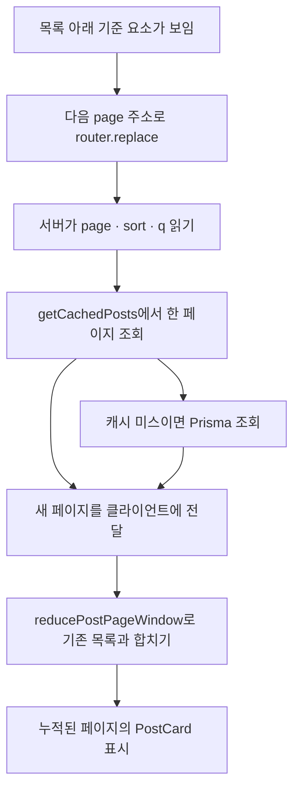
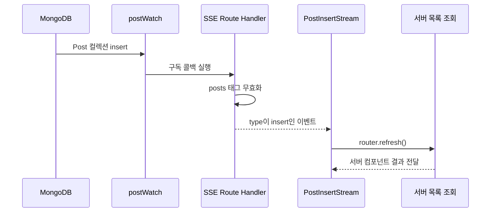
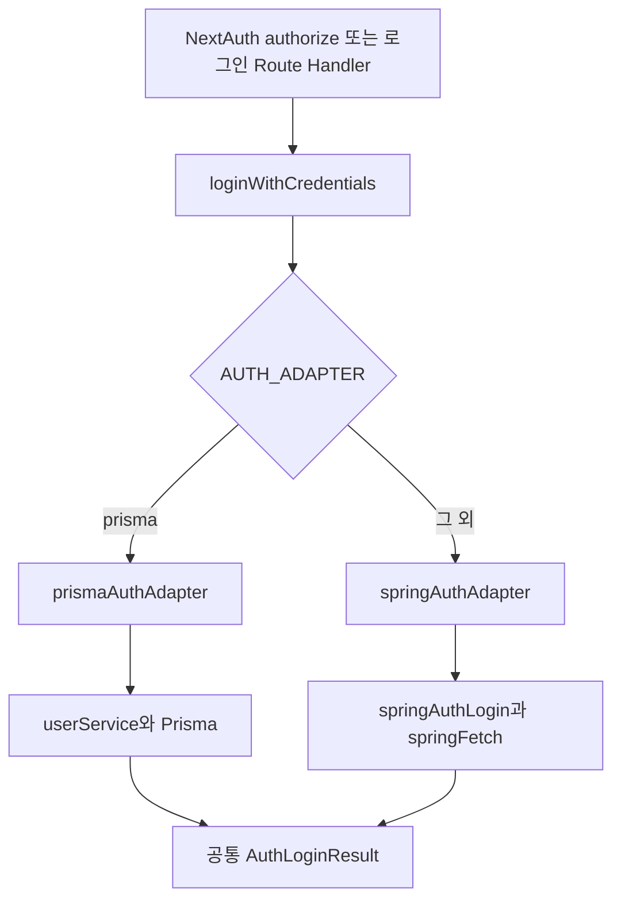

# 2026-11-09 TIL | 무한 스크롤과 인증 구조를 읽고 프론트엔드 프로젝트 준비하기

## 1. 오늘 정리한 내용

오늘은 프론트엔드 프로젝트를 앞두고 구현 범위와 진행 방식을 정리했다. 게시글, 로그인, 댓글처럼 수업에서 다룬 기능을 실제 화면으로 연결하고, 배포한 결과물까지 만드는 것이 이번 프로젝트의 중심이다.

예제 코드에서는 게시글 목록에 무한 스크롤이 추가됐고, 인증 처리는 Action과 Service 사이에 공통 인터페이스를 두는 구조로 바뀌었다. 목록을 계속 이어 보여 주는 일과 서버에서 다음 데이터를 가져오는 일, 로그인 화면과 실제 인증 구현을 각각 나누어 읽었다.

- 프론트엔드 파일럿 프로젝트 일정과 구현 범위
- 서버 페이지 조회를 유지하면서 무한 스크롤 연결하기
- `IntersectionObserver`와 중복 요청 방지
- 이전 페이지를 앞에 붙일 때 스크롤 위치 유지하기
- 게시글 추가를 SSE로 받아 캐시와 화면 갱신하기
- 인증 Action, 공통 Port, Prisma·Spring Adapter
- 공통 fetch 함수의 요청·응답 처리
- `Suspense` 경계와 커밋 전 빌드 확인

---

## 2. 프로젝트 안내에서 먼저 정리한 것

### 2.1 일정과 결과물

파일럿 프로젝트 기간은 **11월 10일 화요일부터 11월 13일 금요일까지**다. 조 편성도 안내됐고, 나는 1조에 배정됐다. 프로젝트를 시작하기 전에 구현 범위와 준비할 내용을 정리했다.

마지막 날은 오전까지 구현을 진행하고 오후에는 발표를 준비하는 흐름이다. 결과 발표는 오후 3시부터, 팀별 약 10분 정도로 안내됐다. 발표 자료는 구현한 기능과 동작을 설명할 수 있도록 준비하고, AI 도구도 활용할 수 있다.

### 2.2 배포는 마지막 날의 작업으로 남기지 않기

강사님이 반복해서 말씀하신 부분은 **첫날부터 배포한 상태로 개발을 이어가라는 것**이었다. 디자인을 모두 완성한 뒤 배포하는 것이 아니라, 기본 프로젝트와 API 연결을 준비하면 먼저 주소를 만들고 그 위에 기능을 계속 추가하는 방식이다.

마지막 날에 처음 배포하면 로컬에서는 보이지 않던 환경 변수나 빌드 문제가 한꺼번에 드러날 수 있다. 이번에는 배포를 완성 직전의 절차로 생각하지 않고, 개발 과정에 포함하려고 한다.

### 2.3 주제는 자유지만 구현 범위는 현실적으로 잡기

글쓰기, 댓글, 좋아요, 회원가입처럼 수업에서 다룬 기능만 연결해도 짧은 프로젝트 기간에 할 일이 많다. 다른 주제를 정할 수는 있지만, 새로운 기능을 많이 넣기보다 기간 안에 이해하고 설명할 수 있는 범위를 잡아야 한다.

인증은 구현하면 좋지만 **NextAuth나 OAuth 자체가 필수는 아니다.** 최소한 DB에 있는 사용자 정보로 로그인이 가능하다는 흐름을 다루는 방향이다. 특정 라이브러리 설정에만 시간을 쓰다가 나머지 화면을 연결하지 못하는 상황을 피하려고 한다.

### 2.4 Action과 Service를 나누고 화면까지 연결하기

페이지 파일에 요청과 처리 코드를 모두 넣기보다 Action과 Service 정도는 분리하는 방향으로 안내됐다. 아키텍처 이름을 많이 사용하는 것보다, 요청을 받는 부분과 실제 데이터 처리를 나누는 것이 먼저다.

이번 프로젝트에서는 Spring까지 새로 만들며 범위를 넓히지 않는다. 별도 API가 필요하면 Node.js·Next.js와 Prisma를 활용할 수 있지만, 백엔드만 구현하고 끝내는 역할 분담은 피해야 한다. 만든 API를 실제 프론트엔드에서 사용하고 결과를 화면으로 표현하는 것까지 연결해야 한다.

AI를 이용한 프로젝트 진행 분석 같은 예시도 소개됐지만, 우리 팀의 확정 기능은 아니다. 추가 기능을 고르기 전에 기본 화면과 데이터 흐름부터 정하는 편이 맞겠다.

---

## 3. 이전 학습과 연결하기

| 이전 기록 | 오늘 이어서 본 내용 |
|---|---|
| [11/05 — CRUD와 캐싱](2026-11-05.md) | 페이지별 조회 캐시, 데이터 변경 후 캐시 무효화 |
| [11/06 — 검색과 SSE](2026-11-06.md) | 검색 조건을 유지한 페이지 이동, 게시글 추가 이벤트 |
| [11/08 — 웹 기초와 React](2026-11-08.md) | 배열을 새로 만들어 목록을 합치기, props와 상태, fetch 응답 처리 |

11월 6일에는 검색어를 `q`에 넣고 서버가 그 조건으로 글을 조회하는 흐름을 정리했다. 오늘 무한 스크롤도 그 구조를 유지한다. 달라진 점은 **한 번 받은 페이지를 클라이언트에서 보관하고, 인접한 페이지를 앞뒤로 붙여 보여 준다는 것**이다.

11월 8일에 복습한 `map`과 배열 전개 문법도 다시 나왔다. 이번에는 단순히 카드 목록을 만드는 수준을 넘어, 어떤 페이지를 유지하고 어떤 페이지를 새로 붙일지 계산하는 데 쓰인다.

---

## 4. 오늘 추가된 코드의 큰 흐름

11월 9일 변경 내용은 크게 다음과 같이 묶었다. 아래 경로는 `lgcns-fe-next/`를 기준으로 한다.

| 구분 | 주요 파일 | 역할 |
|---|---|---|
| 목록 진입 | `app/(post)/posts/page.tsx` | URL 조건을 읽고 서버에서 한 페이지 조회 |
| 목록 상태 | `components/organisms/PostInfinityScrollList.tsx` | 받은 페이지 묶음을 유지하고 카드 렌더링 |
| 페이지 합치기 | `lib/postPageWindow.ts` | 검색 변경·이전·다음·점프에 따라 목록 계산 |
| 스크롤 감지 | `useAdjacentPostPage.ts` | 위·아래 기준 요소를 관찰하고 주소 이동 |
| 위치 보정 | `usePreservePrependScroll.ts` | 이전 글을 위에 붙인 뒤 읽던 위치 유지 |
| 현재 위치 | `useVisiblePostPage.ts` | 화면에서 읽고 있는 페이지 번호 표시 |
| 새 글 알림 | `service/postWatch.ts`, `app/api/posts/stream/route.ts` | DB의 글 추가를 SSE로 전달 |
| 인증 경계 | `actions/authActions.ts`, `service/auth/` | 공통 인증 함수와 구현 선택 |
| HTTP 공통 처리 | `lib/fetchClients.ts` | URL·헤더·본문·응답 처리 |

`useAdjacentPostPage.ts`, `usePreservePrependScroll.ts`, `useVisiblePostPage.ts`는 모두 `components/organisms/`에 있다.

기존 `component/` 폴더는 `components/`로 이동했다. 이 부분은 파일이 새로 많이 보이더라도 기능이 전부 새로 생긴 것은 아니다. 경로를 정리하면서 import도 함께 바뀐 것이다.

---

## 5. 코드 리뷰 ① 무한 스크롤도 서버에서는 한 페이지씩 조회한다

### 5.1 URL 조건에서 시작하기

`PostsContent`는 `page`, `sort`, `q`를 읽는다. 페이지는 1 이상의 정수로 정리하고, 정렬은 `ASC`일 때만 오름차순으로 처리한다. 검색어는 앞뒤 공백과 연속 공백을 정리한 뒤 길이를 제한한다.

```tsx
// app/(post)/posts/page.tsx — 조회와 props 전달 부분
const postList = await getCachedPosts(pageNumber, sortOrder, keyword);

return (
  <PostInfinityWrapper
    posts={postList}
    pageNumber={pageNumber}
    sortOrder={sortOrder}
    keyword={keyword}
  />
);
```

실제 파일에는 검색 폼과 정렬 링크도 함께 있다. 번호를 눌러 이동하는 `PostPaginataionWrapper` 호출은 주석 처리되어 있고, 현재 목록은 `PostInfinityWrapper`를 사용한다. 파일명의 `Paginataion`은 현재 코드의 철자다.

### 5.2 DB 조회와 화면 누적을 분리하기

`getCachedPosts`는 기존처럼 `"use cache"`, `cacheTag("posts")`, `cacheLife("max")`를 사용한다. 페이지 번호·정렬·검색어가 함수 인자로 들어가므로 조회 조건에 따라 캐시가 구분된다.

캐시에서 데이터를 얻지 못하면 `postService.listPosts`가 Prisma로 조회한다. 한 페이지 크기는 20개다.

```typescript
// service/postService.ts — findMany 옵션 중 페이지 처리 부분
skip: (currentPage - 1) * pageSize,
take: pageSize,
```

먼저 전체 개수를 세어 `totalPages`를 구하고, 요청 페이지가 마지막 페이지를 넘으면 실제 조회 페이지를 조정한다. 조회 결과에는 글 목록 외에 `currentPage`, `hasNextPage`, `hasPreviousPage`도 포함된다.

**무한 스크롤이 됐다고 DB가 모든 글을 한 번에 보내는 것은 아니다.** 서버는 한 페이지를 주고, 클라이언트가 이미 받은 페이지들과 합친다. 이 목록 조회는 Spring API로 바뀐 것이 아니라 여전히 Prisma 경로다.



여기서 `router.replace`는 주소 글자만 바꾸는 처리가 아니라 Next.js의 페이지 이동이다. 바뀐 조건으로 서버 컴포넌트가 새 데이터를 전달하고, 같은 목록 컴포넌트가 그 데이터를 받는다.

---

## 6. 코드 리뷰 ② 받은 페이지를 어떻게 이어 붙이는가

### 6.1 페이지 단위로 묶어서 보관하기

`lib/postPageWindow.ts`의 상태는 글 배열 하나가 아니라 페이지별 그룹을 가진다.

```typescript
export type PostPageGroup = {
  page: number;
  posts: PostItem[];
};

export type PostPageWindow = {
  queryKey: string;
  loadedKey: string;
  groups: PostPageGroup[];
  hasNextPage: boolean;
  hasPreviousPage: boolean;
  totalPages: number;
  anchorPage: number;
};
```

예를 들어 2페이지에서 시작해 3페이지를 받으면 `groups`는 2·3페이지 두 묶음을 가진다. 이후 1페이지를 받으면 앞에 붙일 수 있다. 화면에서 현재 읽는 페이지를 표시할 때도 이 묶음이 기준이 된다.

### 6.2 검색 변경과 다음 페이지 추가는 다른 처리다

| 받은 데이터의 조건 | 처리 |
|---|---|
| 검색 조건과 로딩 식별값이 모두 같음 | 기존 상태 반환 |
| 정렬이나 검색어가 달라짐 | 새 한 페이지로 초기화 |
| 이미 가진 페이지 번호 | 해당 그룹 교체 |
| 마지막 페이지 바로 다음 | 뒤에 추가 |
| 첫 페이지 바로 이전 | 앞에 추가 |
| 그 외의 페이지 번호 | 페이지 점프로 보고 초기화 |

다음 페이지를 뒤에 붙이는 부분은 다음과 같다.

```typescript
// lib/postPageWindow.ts — 다음 페이지 처리 분기
if (pageNumber === lastPage + 1) {
  return {
    ...current,
    ...base,
    groups: [...current.groups, { page: pageNumber, posts: posts.posts }],
    hasNextPage: posts.hasNextPage,
  };
}
```

기존 배열에 `push`하는 대신 새 배열을 만든다. 뒤쪽 경계가 바뀌었으므로 `hasNextPage`를 새 응답으로 갱신하고, 앞쪽의 `hasPreviousPage`는 유지한다. 이전 페이지를 붙일 때는 반대로 앞쪽 경계를 바꾼다.

### 6.3 props를 상태에 맞추는 조건

```tsx
// components/organisms/PostInfinityScrollList.tsx
const [windowState, setWindowState] = useState(() =>
  createPostPageWindow(posts, pageNumber, sortOrder, keyword),
);
const view = reducePostPageWindow(windowState, posts, pageNumber, sortOrder, keyword);
if (view !== windowState) setWindowState(view);
```

이 코드는 effect에서 props를 복사하는 방식이 아니라, 렌더링 중 새 props와 기존 상태를 비교해 현재 컴포넌트의 상태를 맞춘다. 같은 조건이면 기존 객체를 그대로 반환하고, 바뀐 경우에만 `setWindowState`를 호출하는 조건이 중요하다. 렌더링할 때마다 무조건 새 객체를 만들어 상태에 넣는 코드로 바꾸면 안 된다.

확인할 부분도 있다. `loadedKey`는 페이지 번호와 글 ID 목록으로 만든다. **같은 페이지에서 ID와 순서는 그대로인데 본문이나 좋아요 수만 달라지면 첫 조건에서 기존 상태를 반환할 수 있다.** 따라서 이 식별값을 데이터 전체가 최신이라는 뜻으로 이해하면 안 된다. 목록 갱신을 직접 실습할 때 확인할 항목으로 남겨 두었다.

---

## 7. 코드 리뷰 ③ 스크롤 감지와 읽던 위치 유지하기

### 7.1 IntersectionObserver와 기준 요소

`useAdjacentPostPage`는 목록 위·아래의 기준 요소를 관찰한다. 아래쪽 요소가 보이고 다음 페이지가 있으면 다음 주소로 이동한다.

```tsx
// useAdjacentPostPage.ts — observer 콜백의 다음 페이지 분기
if (entry.target === bottom && hasNextPage) {
  loadingRef.current = true;
  router.replace(postsListHref(lastPage + 1, sortOrder, keyword), { scroll: false });
  return;
}
```

`loadingRef`는 이동 요청이 겹치지 않도록 막는다. 관찰 콜백이 여러 번 실행될 수 있으므로, 페이지를 요청했다는 사실을 먼저 기록한 뒤 이동한다. 관련 페이지 정보가 바뀌어 effect가 다시 실행되면 잠금을 푼다.

`ref.current`를 바꾸는 것만으로는 다시 렌더링되지 않는다. 화면에 표시할 목록은 state로, 렌더링 자체를 유발할 필요가 없는 요청 잠금은 ref로 나눈 것이다. state도 같은 컴포넌트가 유지되는 동안 보존되므로, 다시 렌더링될 때마다 state가 사라진다는 뜻은 아니다.

`IntersectionObserver`는 사용자가 스크롤했을 때만 호출되는 것은 아니다. 처음 관찰할 때 이미 요소가 보이는 경우에도 콜백이 실행될 수 있다. 위쪽은 `armPreviousRef`를 두고 위로 움직이려는 입력을 확인해, 처음 보인다는 이유만으로 이전 페이지를 계속 불러오지 않도록 했다. [MDN Intersection Observer](https://developer.mozilla.org/en-US/docs/Web/API/Intersection_Observer_API)

effect를 정리할 때는 `observer.disconnect()`를 호출하고, 별도로 등록한 `scroll`·`wheel` 리스너도 제거한다. 11월 6일 EventSource 연결을 정리했던 것처럼, 연결하거나 등록한 작업에는 해제 경로도 필요하다.

### 7.2 replace와 scroll: false

`replace`는 이동할 때 새 방문 기록을 추가하지 않는다. 무한 스크롤로 여러 페이지를 지날 때 매번 뒤로 가기 기록을 쌓는 방식과 구분할 수 있다.

`scroll: false`는 페이지 이동 시 기본 스크롤 조정을 막기 위한 옵션이다. 하지만 이것만으로 위에 추가된 글의 높이까지 보정되는 것은 아니다. [Next.js useRouter](https://nextjs.org/docs/app/api-reference/functions/use-router)

### 7.3 이전 글을 앞에 붙이면 현재 글이 밀린다

이전 페이지를 목록 위에 넣으면 전체 문서 높이가 늘고, 읽던 글도 아래로 밀린다. `usePreservePrependScroll`은 추가 전후의 높이 차이만큼 스크롤을 옮긴다.

```tsx
// components/organisms/usePreservePrependScroll.ts
useLayoutEffect(() => {
  const nextHeight = document.documentElement.scrollHeight;
  const keptPreviousTop =
    firstPage < firstPageRef.current && loadedPages.includes(firstPageRef.current);
  if (keptPreviousTop && scrollHeightRef.current > 0) {
    window.scrollBy(0, nextHeight - scrollHeightRef.current);
  }
  firstPageRef.current = firstPage;
  scrollHeightRef.current = nextHeight;
}, [firstPage, loadedPages]);
```

첫 페이지 번호가 작아졌고 기존 첫 페이지도 남아 있다면, 이전 페이지가 앞에 붙은 상황으로 판단한다. 검색 결과 전체가 바뀐 경우까지 같은 보정을 적용하지 않도록 조건을 둔 것이다.

`useLayoutEffect`는 DOM 반영 뒤 브라우저가 다시 그리기 전에 실행되므로, 밀린 위치가 먼저 보이는 것을 줄이는 데 사용할 수 있다. 모든 effect를 이것으로 바꾸는 것이 아니라 위치 측정과 보정이 필요한 부분에 사용한다. [React useLayoutEffect](https://react.dev/reference/react/useLayoutEffect)

### 7.4 주소의 페이지와 읽고 있는 페이지

목록이 1~3페이지까지 쌓인 상태에서 다시 위로 올라가면, 마지막으로 요청한 페이지와 현재 읽는 페이지가 달라질 수 있다. `useVisiblePostPage`는 `data-post-page`가 붙은 요소의 위치를 읽어 현재 페이지 배지를 표시한다.

네트워크로 요청한 페이지, 클라이언트가 보관한 페이지 묶음, 화면에서 현재 읽는 페이지를 서로 다른 값으로 관리하는 이유를 여기서 볼 수 있었다.

새로고침하면 메모리에 쌓아 둔 1·2페이지는 없어지고 주소에 남은 3페이지부터 다시 시작할 수 있다. 강사님은 이 부분을 설명하며 무한 스크롤을 원하는 이유와 새로고침 후 어디까지 복원할지 기획 단계에서 확인해야 한다고 짚어 주셨다. 계속 내려보는 경험만 필요한지, 읽던 위치와 앞뒤 페이지까지 복원해야 하는지에 따라 구현 범위가 달라진다.

### 7.5 처음 연결할 때 확인한 문제

무한 스크롤을 처음 연결한 코드에서는 주소가 다음 페이지로 바뀌어도 기존 글과 새 글이 합쳐지지 않았고, 이동하면서 스크롤 위치도 달라졌다. 페이지를 이동시키는 코드와 받은 데이터를 누적하는 코드가 따로 필요하다는 점을 확인했다.

이후 목록을 합치는 과정에서는 같은 `key`가 반복되는 문제와 데이터가 계속 늘어나는 반복 실행이 나타났다. 수업 중에는 확인을 위해 잠시 인덱스를 사용하기도 했지만, 최종 코드는 페이지 그룹에 `group.page`, 글 항목에 `post.id`를 사용한다. 중복 데이터를 계속 추가하는 문제를 인덱스 key로 가리는 것이 해결책은 아니다.

반복 실행을 살펴보면서 effect의 의존값, 관찰 대상이 실제로 보이는지, 새 props를 받을 때 기존 데이터를 어떻게 합칠지 함께 확인했다. 최종 코드에서는 관찰 처리를 `useAdjacentPostPage`로 나누고, 요청 잠금과 페이지 묶음 계산을 별도로 둔다.

여기서 기억할 것은 **의존성 배열을 비우면 해결된다고 생각하지 않는 것**이다. 무엇이 effect를 다시 실행하게 하는지, 그 안의 상태 변경이나 라우팅이 어떤 새 입력을 만드는지 순서대로 읽어야 한다.

---

## 8. 코드 리뷰 ④ 새 글 추가와 SSE

### 8.1 알림 목록에서 게시글 변경으로 연결하기

11월 6일에는 좋아요·댓글 알림을 EventSource로 받는 흐름을 정리했다. 오늘 추가된 `PostInsertStream`은 새 글이 생겼다는 이벤트를 받아 현재 화면을 갱신한다.



`postWatch`는 MongoDB change stream에서 `operationType: "insert"`만 관찰한다. 지금 구현을 모든 수정·삭제까지 감지하는 범용 목록 동기화로 이해하면 안 된다.

### 8.2 데이터 갱신과 화면 갱신은 여전히 별개다

```typescript
// app/api/posts/stream/route.ts — publish 내부의 핵심 작업
revalidateTag("posts", { expire: 0 });
sendInsert();
```

실제 `publish`에서는 캐시 무효화 호출을 `try/catch`로 감싼다. 이어서 `data: {"type":"insert"}` 형태의 SSE 메시지를 전송한다.

```tsx
// components/molecules/PostInsertStream.tsx
source.onmessage = (message) => {
  try {
    const value = JSON.parse(message.data) as { type?: unknown };
    if (value?.type === "insert") router.refresh();
  } catch {
    return;
  }
};
```

이벤트에는 새 게시글 전체가 실려 오는 것이 아니다. 변경이 있다는 신호를 받은 뒤 서버 컴포넌트를 다시 요청한다. `router.refresh()` 자체가 서버 데이터 캐시를 무효화하는 것은 아니므로, 앞의 태그 처리와 역할을 나눠서 봐야 한다.

브라우저 탭이 숨겨지면 연결을 닫고, 다시 보이면 연다. 컴포넌트가 없어질 때도 리스너와 연결을 정리한다. 서버에는 연결 유지용 heartbeat가 있지만, 이것도 새 글 이벤트와는 별개다.

---

## 9. 코드 리뷰 ⑤ 인증 구현을 바꿀 수 있도록 경계 만들기

### 9.1 단일 책임과 확장을 코드에 연결하기

강사님은 구조를 나누는 이유를 설명하면서 단일 책임, 개방·폐쇄, 인터페이스 분리를 특히 짚어 주셨다. 폴더 이름이나 특정 패턴을 정답처럼 외우기보다, 맡은 역할을 작게 나누고 서로 연결되는 부분을 줄이는 방향으로 이해했다.

| 원칙 | 오늘 코드에 연결해서 생각한 것 |
|---|---|
| 단일 책임(SRP) | 스크롤 감지, 페이지 합치기, 화면 위치 보정을 각각 분리 |
| 개방·폐쇄(OCP) | 인증 구현이 달라져도 호출부는 공통 `login` 결과를 사용 |
| 인터페이스 분리(ISP) | 호출하는 쪽에 필요한 기능과 데이터의 경계를 명확히 정하기 |

또한 원본 데이터를 직접 바꾸지 않는 불변성을 강조하셨다. `reducePostPageWindow`가 기존 배열을 변경하지 않고 새 결과를 반환하는 부분과 연결된다. 이런 계산 함수는 입력과 결과를 비교하기도 쉽다.

다만 Service라는 폴더에 넣었다고 모두 순수 함수가 되는 것은 아니다. DB 조회·저장과 API 요청에는 외부 효과가 있다. 외부와 통신하는 코드, 받은 데이터를 계산하는 코드, 화면을 그리는 코드를 구분하는 데 초점을 맞추려고 한다.

### 9.2 호출부가 DB 종류를 직접 고르지 않기

오늘 추가된 `actions/authActions.ts`는 인증 구현을 선택하는 위치다.

```typescript
"use server";

import { prismaAuthAdapter } from "@/service/auth/prismaAuthAdapter";
import { springAuthAdapter } from "@/service/auth/springAuthAdapter";
import type { AuthPort, SocialLinkInput } from "@/service/auth/authPort";

function authAdapter(): AuthPort {
  if (process.env.AUTH_ADAPTER === "prisma") return prismaAuthAdapter;
  return springAuthAdapter;
}

export async function loginWithCredentials(email: string, password: string) {
  return authAdapter().login({ email, password });
}

export async function linkAuthSocialAccount(input: SocialLinkInput) {
  return authAdapter().linkSocialAccount(input);
}
```

NextAuth와 로그인 Route Handler는 `loginWithCredentials`를 호출한다. 그 뒤에서 Prisma를 쓸지 Spring을 쓸지 선택하므로, 호출부마다 분기 코드를 반복하지 않는다.

`AUTH_ADAPTER`가 정확히 `prisma`일 때 Prisma 경로이고, 그 외에는 Spring 경로다. 설정을 비워 두면 자동으로 Prisma가 되는 구조가 아니라는 점을 확인해야 한다.

### 9.3 Port는 약속, Adapter는 그 약속에 맞춘 구현

```typescript
// service/auth/authPort.ts — 반환값과 인터페이스
export type AuthLoginResult =
  | { ok: true; user: AuthAccount }
  | { ok: false; message: string };

export type AuthPort = {
  login(input: CredentialLoginInput): Promise<AuthLoginResult>;
  linkSocialAccount(input: SocialLinkInput): Promise<LinkedSocialAccount>;
};
```

호출하는 쪽은 공통 결과의 `ok`를 보고 성공·실패를 나눈다. Prisma와 Spring의 원래 응답이 달라도 Adapter가 `AuthAccount`로 맞춰 준다. Spring의 숫자 `userId`를 문자열 `id`로 바꾸고, `null`일 수 있는 프로필 값을 정리하는 부분이 그 예다.



### 9.4 수업 예제의 Spring 연결과 프로젝트 조건 구분하기

인증 예제에 Spring 연결 코드가 추가됐다는 사실이, 이번 프로젝트에서 Spring 서버까지 구현하라는 뜻은 아니다. 프로젝트에서는 Next.js 중심으로 화면과 기능을 완성하고, 필요하면 Node.js·Prisma로 보완하는 범위를 잡는다.

실제 코드의 전환 범위도 제한적이다. 자격 증명 로그인은 Adapter로 바뀌었지만 게시글 조회는 Prisma다. Spring Adapter의 소셜 계정 연결도 내부에서 Prisma Adapter를 호출한다. API 주소가 선언되어 있다고 모든 기능이 그 주소를 사용하는 것은 아니다.

---

## 10. 코드 리뷰 ⑥ fetch를 공통 함수로 감싸기

### 10.1 같은 요청 준비 코드를 줄이기

`createFetchClient`는 기본 주소와 공통 요청 처리를 묶고, `get`, `post`, `put`, `patch`, `delete`를 반환한다. 로그인 Service는 로그인에 필요한 값과 경로에 집중한다.

수업에서도 요청 주소를 한곳에서 관리하고, 반복되는 예외 처리와 응답 처리를 공통화하는 방향을 설명했다. API 명세의 `success`, `message`, `data`, `code` 같은 응답 구조를 먼저 확인해야 화면에서 어떤 값을 사용할지 정할 수 있다. 서버가 제공하는 사용자용 오류 메시지를 전달하는 흐름도 함께 봤다.

```typescript
// service/spring/sprignAuthService.ts — 로그인 요청과 결과 판별
const response = await springFetch.post<SpringLoginData>(matchApiUrl.auth.login, {
  email: email.trim(),
  password,
});
if (!response.success || !isLoginData(response.data)) {
  return {
    ok: false as const,
    message: response.message || "이메일 또는 비밀번호가 올바르지 않습니다.",
  };
}
return { ok: true as const, data: response.data };
```

파일 이름은 현재 `sprignAuthService.ts`다. 역할은 Spring 로그인 Service이지만 import 경로를 적을 때는 실제 철자를 따라야 한다.

### 10.2 요청이 만들어지는 순서

| 단계 | 처리 |
|---|---|
| 주소 | 기본 URL과 경로를 합치고 쿼리는 `URLSearchParams`로 구성 |
| 헤더 | 기본 `Accept`와 호출자가 전달한 헤더 합치기 |
| 본문 | 일반 데이터는 JSON, `FormData`는 그대로 전달 |
| 중단 | `AbortController`로 요청 signal 연결 |
| 응답 | Content-Type에 따라 JSON 또는 텍스트 읽기 |
| 결과 | 공통 성공·실패 객체로 반환 |

쿼리에서 제외하는 값은 `null`과 `undefined`다. 숫자 `0`이나 불리언 `false`까지 빈 값으로 버리지 않는다. `FormData`에서는 multipart 경계를 런타임이 만들 수 있도록 코드가 `Content-Type`을 직접 추가하지 않는다.

### 10.3 fetch의 오류와 공통 함수의 오류 규칙

11월 8일에 fetch는 404·500 응답만으로 reject하지 않는다는 내용을 정리했다. 오늘 공통 함수는 응답을 읽은 뒤 Spring 형식인지 먼저 확인하고, 그 형식이 아니면 `response.ok`를 확인한다.

```typescript
// lib/fetchClients.ts — 응답을 해석하는 순서
const response = await fetch(buildUrl(baseUrl, path, options.params), init);
const parsed = await readBody(response);
const spring = toSpringBody<T>(parsed, response.status);
if (spring) return spring;
if (!response.ok) return failure(response.status, "요청에 실패했습니다.");
return {
  success: true,
  code: response.status,
  message: "",
  data: (parsed ?? null) as T | null,
};
```

요청 중 예외가 발생하면 `catch`에서 `success: false`, `code: 0`, `data: null` 형태로 반환한다. 호출부에서는 실패가 항상 throw된다고 기대하지 않고 `response.success`를 확인해야 한다.

Spring 형식의 본문을 HTTP 상태보다 먼저 반환하므로, HTTP 실패 상태와 본문의 `success`가 충돌할 때 어떤 값을 기준으로 삼을지도 확인할 부분이다. `post<SpringLoginData>`처럼 타입을 적었다고 응답 전체가 실행 중 자동 검증되는 것도 아니다. 현재 `isLoginData`는 액세스 토큰, 숫자 사용자 ID, 이메일을 중심으로 확인한다.

### 10.4 timeout을 지원하는 것과 실제로 설정하는 것

공통 함수에는 timeout 옵션이 있지만, 로그인 호출은 그 값을 전달하지 않는다. 따라서 모든 로그인 요청에 자동으로 일정 시간 제한이 걸린다고 볼 수 없다.

또한 요청 취소와 네트워크 실패는 현재 같은 실패 코드로 합쳐진다. 프로젝트에서 사용자 취소와 서버 연결 실패를 다르게 안내하려면 공통 함수의 반환 규칙까지 살펴봐야 한다.

---

## 11. 토큰 이름만 보고 같은 것으로 생각하지 않기

Spring 인증 성공 뒤에는 Spring이 발급한 토큰과 Next.js에서 별도로 만든 JWT가 함께 등장한다.

```typescript
// lib/authOptions.ts — credentials 분기 일부
token.springAccessToken = user.accessToken;
token.refreshToken = user.refreshToken;
token.accessToken = await signAccessToken({
  id: user.id,
  email: user.email ?? "",
  name: user.name ?? "",
});
```

`springAccessToken`은 Spring 응답에서 받은 값이고, `accessToken`은 `signAccessToken`으로 새로 만든 값이다. 세션의 `accessToken`에는 후자가 들어간다. 현재 세션 콜백은 `springAccessToken`을 세션에 복사하지 않는다.

11월 5일에 JWT 서명과 권한 검사를 정리한 것이 생각났다. 토큰은 문자열이라는 모양보다 누가 발급했고 어느 서버가 검증하는지가 중요하다. 로컬에서 만든 JWT를 Spring에서도 자동으로 받아 준다고 가정하면 안 된다.

refresh token을 저장하는 필드가 있다는 것과 만료 시 자동 재발급 흐름이 구현되어 있다는 것도 별개다. 현재 인증 코드에는 토큰 만료를 감지해 재발급 API를 호출하는 흐름이 없으므로, 자동 갱신이 필요하면 추가로 구현해야 한다.

---

## 12. Suspense 안에서 기다리도록 조회 위치 바꾸기

홈 화면의 데이터 조회는 `HomePosts.tsx`로 이동했다. 기존에는 바깥 `Home`에서 조회를 기다린 뒤 `<Suspense>` 아래에 이미 준비된 데이터를 넘겼다. 변경 후에는 기다리는 컴포넌트 자체가 경계 안에 들어간다.

```tsx
// app/(main)/page.tsx — 구조를 중심으로 줄인 코드
<Main>
  <HeroSection />
  <Suspense fallback={<p>최신 글을 불러오는 중...</p>}>
    <HomePosts />
  </Suspense>
</Main>
```

`HomePosts`에서 사용자와 글 목록을 읽고, 이후 사용자별 좋아요 정보를 조회한다. 공통 데이터와 사용자별 상태를 분리하는 기존 흐름은 유지하면서, 대기 위치를 `Suspense` 안으로 옮긴 것이다.

로딩 문구를 작성하는 것만으로 충분한 것이 아니라, 실제로 기다리는 작업이 어느 경계 안에서 실행되는지 봐야 한다.

커밋 전 실행 명령에도 `npm run build`가 추가됐다. 개발 화면이 뜨는지 확인하는 것과 배포용 빌드가 통과하는지 확인하는 것은 별개다. 첫날부터 배포하라는 안내와 연결해서 기억하려고 한다.

---

## 13. 헷갈리기 쉬운 부분과 확인 사항

| 구분 | 확인할 내용 |
|---|---|
| 무한 스크롤 / 전체 데이터 일괄 조회 | 서버는 한 페이지씩 주고 클라이언트가 묶음을 유지 |
| `router.replace` / `router.refresh` | 다른 URL 조건으로 이동 / 현재 경로의 서버 결과 갱신 |
| 캐시 무효화 / 화면 갱신 | 서버 데이터의 유효성 처리 / 브라우저가 새 결과를 받는 처리 |
| 일반 state / `useOptimistic` | 화면 상태 관리 / 서버 처리 중 임시 결과를 먼저 표현 |
| `scroll: false` / 높이 보정 | 이동 시 기본 스크롤 조정 방지 / 위에 추가된 콘텐츠 높이 반영 |
| Port / Adapter | 공통 입출력 약속 / 실제 인증 구현과 데이터 변환 |
| Spring 연결 예제 / 프로젝트 구현 범위 | 코드 학습 대상 / 이번 프로젝트에서 만들기로 정한 범위 |
| 토큰 보관 / 토큰 자동 갱신 | 값을 저장하는 코드 / 만료를 감지하고 재발급하는 흐름 |

무한 스크롤은 목록이 늘어나는 모습만 확인하지 않고, 검색어 변경·중간 페이지 진입·빈 결과·마지막 페이지·같은 ID의 글 수정까지 비교해야 한다. 현재 코드는 offset 방식이라 새 글이 앞에 추가되면 페이지 경계도 달라질 수 있다. 중복이나 누락 없이 보이는지 확인할 항목이다.

문서에서 설명하는 의도와 실제로 실행되는 코드도 구분해서 읽었다. 선언만 있는 API 경로, 주석으로 남은 fetch 예제, 현재 호출부가 없는 사용자 조회 함수를 모두 구현 완료된 기능으로 세면 안 된다.

---

## 14. 다음에 직접 해볼 작업

### 14.1 프로젝트에서 먼저 진행할 작업

먼저 팀에서 주제와 핵심 사용자 흐름을 정하려고 한다. 로그인부터 주요 화면 이용까지 짧은 시연이 가능하도록 최소 기능을 잡고, 첫날 기본 프로젝트를 배포해 주소를 공유하는 것부터 진행하겠다. 실제 API 연결에 필요한 환경 변수와 배포 환경도 초반에 확인할 생각이다.

역할을 나누더라도 각자 맡은 데이터가 화면에 나타나는 과정까지 연결하려고 한다. Action은 요청을 받아 전달하고, Service는 검증과 데이터 처리를 맡도록 구성해 볼 예정이다. 우리 프로젝트에 필요한 인증 범위를 먼저 정하고, OAuth를 추가할지는 기본 로그인과 화면 연결 상태를 보고 결정하려고 한다.

### 14.2 이어서 확인할 설명과 개인 복습

수업에서는 공통 오류 모달을 Provider·Context로 관리하는 방향과 채팅·외부 API 연결도 언급됐다. 오늘 확인한 코드에서 그 기능들이 모두 완성된 것은 아니므로, 추가 코드가 올라오면 실제 연결 범위를 확인하려고 한다.

무한 스크롤은 별도의 복습 항목으로 남겼다. 중간 페이지 주소로 직접 들어간 뒤 아래로 내려 다음 페이지를 붙이고, 다시 위로 올라 이전 페이지를 붙이는 흐름을 확인하고 싶다. 검색 조건을 바꾸면 이전 목록이 초기화되는지, 위에 글이 붙어도 읽던 위치가 유지되는지도 함께 볼 생각이다.

공통 fetch 함수는 성공 응답뿐 아니라 잘못된 로그인, 연결 실패, JSON 형식이 다른 응답도 비교해 보고 싶다. 직접 실행하기 전에는 타입 선언과 실제 응답 형식부터 맞추고, 오류가 throw되는지 결과 객체로 돌아오는지 호출부와 함께 확인하겠다.

발표는 마지막에 급하게 화면을 모으기보다 개발하면서 주요 흐름을 기록해 두려고 한다. 어떤 기능을 구현했고 각 코드가 어떤 역할을 하는지, 추가로 확인할 부분은 무엇인지 설명할 수 있도록 준비하겠다.

---

## 15. 오늘의 회고

프로젝트를 앞두고 나니 수업에서 본 기능을 각각 아는 것과 하나의 서비스로 연결하는 일이 다르다는 생각이 들었다. 로그인, 글 목록, 캐시, 실시간 갱신이 모두 연결되어야 사용자가 끊김 없이 이용할 수 있다.

무한 스크롤도 단순히 다음 데이터를 더하는 기능으로만 보면 놓치는 부분이 많았다. 검색 조건이 바뀌었는지, 이미 받은 페이지인지, 이전 글을 붙인 뒤 화면이 밀리지 않는지까지 상태와 화면을 함께 다뤄야 했다.

인증 코드에서는 호출부와 구현을 나누는 이유가 더 구체적으로 보였다. 이름만 Action과 Service로 나누는 것보다, 구현이 달라져도 호출하는 쪽이 같은 입력과 결과를 사용할 수 있도록 경계를 잡는 것이 중요했다.

이번 프로젝트에서는 기능 수를 늘리는 것보다 기본 흐름을 먼저 연결하고 배포한 뒤 확장하려고 한다. 예제를 참고하더라도 어떤 요청이 어디로 가고 어떤 결과가 화면에 반영되는지는 직접 설명할 수 있도록 정리해 두고 싶다.

**오늘의 한 줄 정리**

서버의 데이터 처리와 클라이언트의 화면 상태를 구분해서 읽고, 작게 연결해 배포하는 순서로 프로젝트를 준비했다.

---

## 16. 참고 자료

- 프론트엔드 파일럿 프로젝트 조 편성·일정 공지 및 프로젝트 안내 메모
- [11월 9일 오전 수업](https://www.youtube.com/watch?v=73lPYy0atgU)
- [11월 9일 프로젝트 안내 — 처음 20분](https://www.youtube.com/watch?v=GTu0_flFKao)
- [무한 스크롤·Spring fetch 정리](https://github.com/TheUNIONGraphix/lgcns-dev-7th-fe/blob/24fe0a2cde4d6667b0381a004a81f3beaa38d9e9/docs/2026-11-09-infinite-scroll-spring-fetch.md)
- [11월 9일 코드 변경](https://github.com/TheUNIONGraphix/lgcns-dev-7th-fe/compare/b10c94db42cb9c58d509f06797066b099535a223...24fe0a2cde4d6667b0381a004a81f3beaa38d9e9)
- [Next.js 예제 코드](https://github.com/TheUNIONGraphix/lgcns-dev-7th-fe/tree/24fe0a2cde4d6667b0381a004a81f3beaa38d9e9/lgcns-fe-next)
- [Next.js useRouter](https://nextjs.org/docs/app/api-reference/functions/use-router)
- [React useLayoutEffect](https://react.dev/reference/react/useLayoutEffect)
- [MDN Intersection Observer](https://developer.mozilla.org/en-US/docs/Web/API/Intersection_Observer_API)
- [11월 5일 TIL](2026-11-05.md)
- [11월 6일 TIL](2026-11-06.md)
- [11월 8일 TIL](2026-11-08.md)
